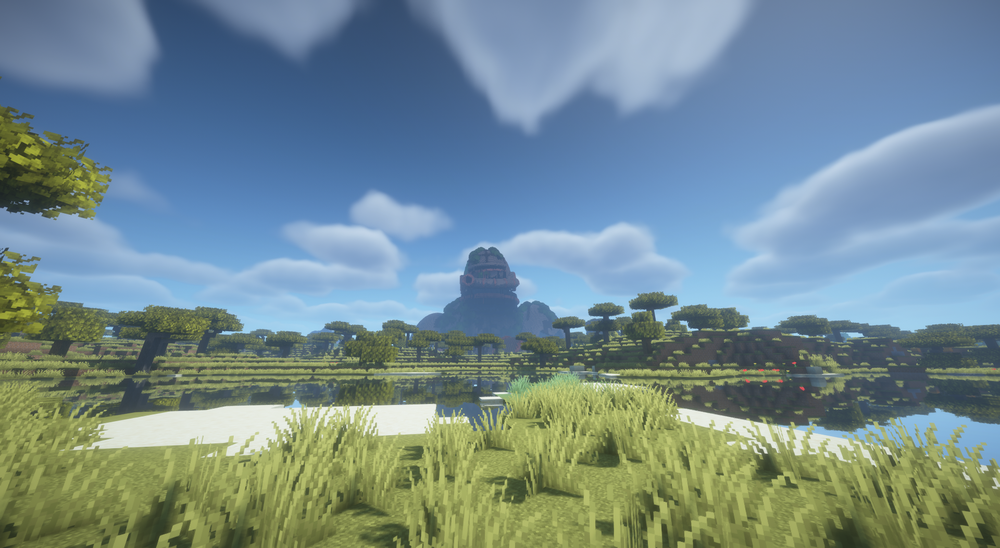

# Relic Mod

Rare, monumental discoveries for Minecraft: a desert obelisk, an overgrown machine colossus with a detached arm, and a crowned titan skull with a broken spine.

**Current test build: 0.1.0-alpha.3 for Minecraft 26.2 / Fabric.** The build selects the checked-in **Colossus v3, Obelisk v3, and Titan Skull v3** NBT exports. All three have natural worldgen resources. This is a visual integration build, not an implementation of planned rewards or encounters. Broader multi-seed and client visual acceptance remain pending.

**Latest integration work, October 1, 2026:** V3 exports are copied byte-for-byte for manual placement; derived worldgen templates add a replaceable center anchor for complete cross-chunk generation. Burial offsets, footprint filters, and upper terrain-height bounds are revised. Legacy DataVersion 3105 is preserved so Minecraft performs its normal template migration; it is not relabeled as 4903. See [V3 integration](docs/technical/V3_INTEGRATION.md).

**Obelisk v3** revises the shape to a tapered square antiprism with eight triangular
faces, a 45-degree rotated crown, and only eight blocks of burial.

**[Titan Skull v3](relics/titan-skull/docs/TITAN_SKULL_V3.md)** develops the next asset study: a crowned,
weathered skull based on the opening of *D.E.A.D.*, now approximately Colossus-head
scale, with a broken, partly buried spine and its local grassy mound included in the export.

## In-game demo

**New offline asset studies, October 2:** [Colossus V4](relics/colossus/docs/COLOSSUS_V4_EXPORTS.md)
adds rear armour damage and a raised right hand. **B / open machine frame is the
selected V4 design**; A remains available for comparison. [View the comparison](relics/colossus/design/generated/colossus-v4-open/colossus-v4-changes-review.png).
[Titan Skull V4](relics/titan-skull/docs/TITAN_SKULL_V4_EXPORTS.md) adds interrupted
deposits in meadow, dry-earth, sand and rock palettes.
[Obelisk V4](relics/obelisk/docs/OBELISK_V4_EXPORTS.md) adds restrained weathering
and a sandy foundation site. Latest revisions:
[Colossus V4.1](relics/colossus/docs/COLOSSUS_V4_1.md) lays the right palm upward
with curled fingers; [Obelisk V4.1](relics/obelisk/docs/OBELISK_V4_1.md) uses
consistent sandstone sides and larger cracks. **Colossus V4.1 is visually accepted.**
The latest [Obelisk V4.2](relics/obelisk/docs/OBELISK_V4_2.md) uses warmer ochre
stone and missing pieces without contrasting crack lining; review pending.
Alpha 3 uses V3.

**Colossus V3 in normal terrain with shaders**, captured in Minecraft by the
user on October 1, 2026. These are Alpha 3 screenshots, not Blender previews
or the new V4 studies.



See the [three-image demo gallery](relics/colossus/demo/README.md) for the savanna
approach, river view and landscape overview. Shader details were not recorded;
these images do not establish performance or general shader compatibility.

## Repository layout

```text
relics/
  colossus/       # README, docs/, design/, gameplay/, demo/
  obelisk/       # README, docs/, design/, gameplay/
  titan-skull/   # README, docs/, design/, gameplay/
  ruined-tower/  # Planning folders; no asset yet
  world-tree/    # Planning folders; no asset yet
docs/
  project/       # Shared concept, lore, and implementation plan
  technical/     # Blender workflow, target environment, and worldgen
  testing/       # Test reports and evidence
src/             # Mod source and packaged resources, kept separate
tools/           # Shared generators, converters, renderers, and build tools
tests/           # Automated checks
structures-src/  # Alpha structure-source metadata
```

Start with the [relic index](relics/README.md) or the
[shared documentation index](docs/README.md). Each relic groups its design history,
asset configs, Blender/export files, and gameplay decisions. Build selection is
explicitly defined by `tools/integrate_v3.py`; moving exports alone does not select them.

## Structures in Alpha 3

| Relic | Overall dimensions, including base (X/Y/Z) | Design |
| --- | --- | --- |
| Obelisk v3 | 25 × 185 × 25 blocks | Tapered square antiprism, rotated crown, solid core, 8-block buried foot |
| Colossus v3 | 181 × 209 × 227 blocks | Dome helmet, broad armor, vegetation, detached arm, underground abdomen and torn hip; nominal ground Y77 |
| Titan Skull v3 | 121 × 79 × 203 blocks | Crowned skull, broken spine and exported grassy mound; nominal ground Y8 |

All three use vanilla blocks and generate in suitable new Overworld chunks. Each complete structure rotates as one unit. There is currently one prepared variant per type. Optional biome mappings support Terralith and Biomes O' Plenty; neither is a required dependency.

## Installation

| Requirement | Tested alpha version |
| --- | --- |
| Minecraft Java Edition | 26.2 |
| Java | 25 |
| Fabric Loader | 0.19.5 |
| Fabric API | 0.160.0+26.2 |
| Lithostitched | 1.8.0+beta6 for Fabric 26.2 |

See [Target environment](docs/technical/TARGET_ENVIRONMENT.md) for historical installation details and [Alpha 3 test report](docs/testing/ALPHA_3_TEST_REPORT.md) for V3 checks and their limits.

1. Install Fabric for Minecraft 26.2.
2. Put `relics-0.1.0-alpha.3+mc26.2.jar`, Fabric API, and Lithostitched in `mods/`.
3. Create a fresh test world with structure generation enabled. Relics are not retroactively added to existing chunks.

Dependencies are available from [Lithostitched](https://modrinth.com/mod/lithostitched) and [Fabric API](https://modrinth.com/mod/fabric-api). Their JARs are not bundled with our release.

To update, fully exit Minecraft and replace the old Relic JAR. Existing structures retain their previous appearance. Use a new test world or unexplored regions to see new geometry. Structure IDs and distribution rules are unchanged, so `/locate` may still return an old location.

With cheats or server operator permissions:

```mcfunction
/locate structure relics:obelisk
/locate structure relics:colossus
/locate structure relics:titan_skull
```

Searches may take time because suitable sites are rare. A successful `/locate` does not prove that every structure chunk has generated. In a separate creative test world, `/place template relics:obelisk` and `/place template relics:colossus` bypass site selection. The supplied position is the template's lower corner, not its intended ground level.

## Build and modify

Python 3.11 or newer is sufficient to generate, test, and package the mod. There is no custom Java code, so this build does not require Gradle, Loom, or Java compilation.

```shell
python tools/build.py
python -m unittest discover -s tests -v
```

On Windows, `./build.ps1` is also available. It looks for Python in PATH, then the existing Codex Python runtime path; it installs nothing.

Outputs are written to `dist/`, including `SHA256SUMS.txt`. The build regenerates NBT from source and uses fixed archive timestamps. Git tracks generators, worldgen data, and selected asset deliverables directly inside each `relics/<relic>/design/generated/<asset>/` directory: `*review.png`, `*-source.blend`, whole `.nbt` templates, `.schem` exports, `.design.json`, `.ots.json`, and `verification.json`. Render scenes, Blender backups, OBJ/MTL intermediates, individual renders, tile folders and manifests, build outputs, and local reference media are excluded through `.gitignore`.

The selection contract in [tools/integrate_v3.py](tools/integrate_v3.py) defines packaged V3 sources, sizes and ground levels. Changes to dimensions or ground level require matching worldgen filter changes. Export manifests record dimensions, ground level, and checksums. The functions in [tools/relic_assets.py](tools/relic_assets.py) remain historical alpha generators, not the default build inputs.

The exporter supports whole templates and rigid tiles. Natural generation uses only whole templates, so the arm cannot disappear because of a failed piece connection.

## Reference-based Blender assets

Review sheets, editable Blender sources, NBT/Schematic exports, and export metadata are kept in
each relic's `design/generated/<asset>/` directory under [relics/](relics/README.md), grouped by asset version. These are
design exports; only the three V3 versions are explicitly selected for Alpha 3.

The implemented asset pipeline is **Blender → triangulated OBJ → local, open-source ObjToSchematic 1.0 → Sponge `.schem` → Java `.nbt`**. Setup, materials, air handling, and commands are documented in [Blender workflow](docs/technical/BLENDER_WORKFLOW.md).

| Asset | Dimensions X/Y/Z | Blocks | Design |
| --- | --- | --- | --- |
| [Colossus v2](relics/colossus/docs/COLOSSUS_V2.md) | 181 × 160 × 227 | 182,734 | Bronze dome helmet, respirator hoses, broad armor, vegetation, and detached arm |
| [Colossus v3](relics/colossus/docs/COLOSSUS_V3.md) | 181 × 209 × 227 | 221,221 | Extends v2 underground to a torn hip; nominal surface at NBT Y ≈ 77 |
| [Colossus V4 A: open](relics/colossus/docs/COLOSSUS_V4_EXPORTS.md) | 181 × 209 × 223 | 221,452 | Rear damage, raised right hand, removed chest piston; comparison alternative |
| [Colossus V4 B: frame](relics/colossus/docs/COLOSSUS_V4_EXPORTS.md) | 181 × 209 × 223 | 222,621 | Selected V4 design with open broken chest machinery; integration pending |
| [Obelisk v2](relics/obelisk/docs/OBELISK_V2.md) | 23 × 209 × 19 | 90,497 | Flat crown, warm mineral bands, solid sandstone core, and a 32-block buried foot |
| [Obelisk v3](relics/obelisk/docs/OBELISK_V3.md) | 25 × 185 × 25 | 93,153 | Tapered square antiprism, rotated crown, solid core, and an 8-block buried foot |
| [Obelisk V4](relics/obelisk/docs/OBELISK_V4_EXPORTS.md) | 59 × 185 × 60 | 95,038 | Same monolith, shallow chips, weathering, scattered sand and foundations |
| [Obelisk V4.1](relics/obelisk/docs/OBELISK_V4_1.md) | 59 × 185 × 60 | 94,593 | Consistent sandstone facets, three branching cracks, four larger edge spalls |
| [Obelisk V4.2](relics/obelisk/docs/OBELISK_V4_2.md) | 59 × 185 × 60 | 94,422 | Warm ochre/clay facets, same-material recesses, two additional missing edge chunks |
| [Colossus V4.1 frame](relics/colossus/docs/COLOSSUS_V4_1.md) | 181 × 209 × 235 | 223,161 | Palm-up right hand, curled fingers; preserved V4 B body and chest |
| [Titan Skull v1](relics/titan-skull/docs/TITAN_SKULL_V1.md) | 185 × 203 × 103 | 103,943 | Organic crown, hollow cranium, open jaw, and curved lateral spur; nominal ground Y ≈ 13 |
| [Titan Skull v2](relics/titan-skull/docs/TITAN_SKULL_V2.md) | 117 × 80 × 105 | 149,894 | Approximately 76-block skull, complete rear, and solid exported mound; nominal ground Y8 |
| [Titan Skull v3](relics/titan-skull/docs/TITAN_SKULL_V3.md) | 121 × 79 × 203 | 264,355 | Same skull scale, nine partly buried vertebrae, two fractures, and extended exported hill |
| [Titan Skull V4](relics/titan-skull/docs/TITAN_SKULL_V4_EXPORTS.md) | 117 × 79 × 179 | 136,569 each | Preserved anatomy, brighter fossil palette, interrupted deposits; four ground variants |

Dimensions include buried geometry and, for the Colossus, the detached arm. Absolute scale is an artistic estimate from the references. Previews render actual exported NBT blocks in Blender. Titan Skull v2/v3 include their local hills in the export; distant scenery and scale figures are presentation aids. Only V3 versions are selected by Alpha 3; human client visual acceptance remains separate from server checks.

At their nominal ground planes, Obelisk v3 exposes approximately **177 block
layers**, versus **132** for Colossus v3. It therefore rises about **45 blocks
(34%) higher above terrain**, although the Colossus is taller overall. This is
a chosen visual relationship, not a measured ratio between the separate references.

Titan Skull v2/v3 is approximately **76 blocks tall including its crown**, about
**20% taller than the Colossus's measured 63-block helmet shell**. Its total
template includes the supporting mound and foundation; the head-size comparison
uses actual NBT geometry at the same block scale.

### Convert a schematic

Sponge v2/v3 schematics can be converted without Minecraft or extra Python packages:

```shell
python tools/schem_to_nbt.py model.schem relics/colossus/design/imported/model.nbt --air omit
```

- `--air omit` skips all air and preserves existing terrain there, including inside modeled rooms.
- `--air keep` includes all air in the export box and can clear terrain outside the silhouette.
- `minecraft:structure_void` is always omitted.
- `--tile-size 32` adds tiles and relative origins in `model.manifest.json`.

The air policy is mandatory. The converter does not automatically distinguish room air from exterior air. Coordinates are local to the lower model corner; the schematic offset is recorded rather than added. Block names, states, and `DataVersion` are preserved without migration. Entities and block entities, such as filled chests, are rejected with an error.

ObjToSchematic exports currently use DataVersion **3105**, while the target game uses **4903**. Target-game validation remains necessary. Obelisk v2/v3 explicitly fill enclosed cells before schematic export; the Colossus assets use surface voxelization.

### Previews

The optional alpha renderer uses Pillow and simplified block colors:

```shell
python -m pip install Pillow
python tools/render_preview.py
```

Images are written to `relics/<relic>/design/generated/alpha/`. Use `--output <directory>` to collect them in a custom directory instead. They are geometry previews, not Minecraft screenshots, and are not needed for the mod build. The Blender asset pages provide commands for textured NBT previews and reference comparison sheets.

## Configure density and enabled relics

Generate a world-specific override datapack, for example more frequent discoveries without colossi:

```shell
python tools/configure.py --density frequent --disable colossus
```

Profiles are `rare`, `normal`, and `frequent`. Repeat `--disable` for `obelisk`, `colossus`, and `titan_skull` as needed. Put `dist/relics-settings.zip` in the world's datapack directory with higher priority than the mod data. Load settings at world/server startup; `/reload` alone is not assumed sufficient for these worldgen changes.

Existing relics remain. While a type is disabled, `/locate` cannot find its existing sites either; re-enabling restores searches and future generation. Profiles control candidates, not guaranteed discoveries: biomes and terrain reject unsuitable sites. There is no settings menu or built-in rejection statistics.

## Known alpha limits

- Grid-based terrain checks can miss small pools and edges between sample points.
- V3 templates omit air and preserve terrain in unspecified cells. Buried cavities are not automatically excavated; final interiors and routes are not implemented.
- Precise collision checks against Dungeons & Taverns or other structures are not implemented.
- Shapes are fixed. Seed-dependent generator variants are a development tool, not selected per discovery.
- There is no new loot, movement mechanic, quest system, or custom sound.
- The titan skull now has worldgen resources but no authored mob encounters or special loot. The ruined tower and world tree are not implemented.

## Documentation

- [Shared documentation index](docs/README.md)
- [Relic design and gameplay index](relics/README.md)
- [Technical implementation plan](docs/project/UMSETZUNGSPLAN.md)
- [Lore bible and design guide](docs/project/LORE-BIBLE.md)
- [Concept and reference catalog](docs/project/Minecraft-Relikte-Modplan.md)
- [Alpha world generation](docs/technical/WORLDGEN.md)
- [Blender workflow](docs/technical/BLENDER_WORKFLOW.md)
- [Alpha 2 test report](docs/testing/ALPHA_2_TEST_REPORT.md)
- [Alpha 3 V3 integration test report](docs/testing/ALPHA_3_TEST_REPORT.md)
- [Historical Alpha 1 test report](docs/testing/ALPHA_TEST_REPORT.md)
- [Changelog](CHANGELOG.md)

Shared documentation is maintained in English; the V4 in-game review notes are
recorded in German. Links and pipeline paths follow the per-relic layout above.

An open-source license has not yet been selected; mod metadata uses `All-Rights-Reserved`. Third-party reference images and mod JARs are not included in the published package.
