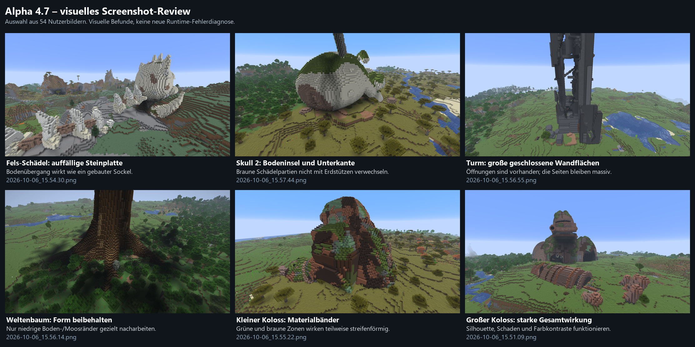

# Alpha 4.7 — user screenshot review

October 6, 2026. The user captured **54 native Minecraft PNGs**, 1920 × 1054,
between 15:43:58 and 15:57:57 in the installed Alpha 4.7 showcase and terrain
saves. All 54 were inspected in numbered contact sheets; critical details were
also inspected at original resolution. Original and archived PNG hashes match.

This is an **assistant visual review**, not new user artistic approval, a new
runtime acceptance run, or authorization to implement the proposed changes.
The models, mod and worlds were not edited during the review.

## Evidence

- [Numbered images 01–09](reviews/alpha4-7-user-review/contact-sheet-01.png)
- [Numbered images 10–18](reviews/alpha4-7-user-review/contact-sheet-02.png)
- [Numbered images 19–27](reviews/alpha4-7-user-review/contact-sheet-03.png)
- [Numbered images 28–36](reviews/alpha4-7-user-review/contact-sheet-04.png)
- [Numbered images 37–45](reviews/alpha4-7-user-review/contact-sheet-05.png)
- [Numbered images 46–54](reviews/alpha4-7-user-review/contact-sheet-06.png)
- [Native screenshot inventory and published-image hashes](reviews/alpha4-7-user-review/manifest.json)

The seven published sheets are labeled, resized montages, not unmodified native
screenshots. All 54 full-resolution PNGs remain unchanged in the local archive
`build/screenshot-review/20261006-alpha4-7-user-review/originals/` and the profile's
screenshots directory. Test saves, backups and local JARs are not published here.

## Overall finding

The relics work as monumental discoveries. The main remaining visual issue is
**ground integration**, not a reason to redesign every model. A supported model
can still look staged on a pedestal. Conversely, a dark gap in a screenshot does
not establish missing substrate; intentional raised root arches must remain open.
The [passing technical contact checks](../testing/ALPHA_4_7_TEST_REPORT.md) are
separate from these observations.

## Per-structure review

| Structure | Observation and recommendation |
| --- | --- |
| Large Colossus | Retain the current form. The silhouette, detached pieces, damaged shell and material contrasts convincingly read as a destroyed giant machine; natural placement works well. |
| Obelisk | Largely finished. A clear landmark with a coherent sandy setting. Long faces remain deliberately monumental but somewhat uniform; at most, restrained weathering rather than a redesign. |
| Meadow Skull | Face and crown read well. Deposits along the spine sometimes look like regularly arranged ground strips. |
| Dry Skull | Palette works in the savanna. Some elevated earth around the vertebrae reads as individual supports rather than naturally accumulated soil. |
| Sand Skull | The most convincing Skull/terrain join in this image set. Do not assume every variant needs additional burial. |
| Rock Skull | Highest-priority ground issue: the broad gray skirt looks like a constructed stone platform. Retain the anatomy and investigate the transition into the hillside. |
| Small Colossus | Form, damage and material contrasts work. Green/brown zones appear strongly banded from the rear; targeted material distribution would be preferable to remodeling the whole relic. |
| World Tree | Retain accepted wood geometry and foliage. Roots convey age and scale. Some low moss/soil edges remain geometric; only investigate those edges, not fill intentional root arches. |
| Ruined Tower | Open sides and visible internal spaces are improvements. Large continuous wall surfaces and straight edges still dominate; selective wall interruptions and less box-shaped rubble could strengthen the ruined appearance. |
| Skull 2 | Face, pose and sword are distinctive. The stepped ground island and dark lower outline can still look staged. Brown skull surfaces include mineral artwork and must not automatically be classified as earth supports. |

## Proposed priorities — not implemented

1. Rock Skull: make the visible stone skirt join the slope less like a platform.
2. Skull 2: inspect the ground-island perimeter and rear contact zone before
   changing the overall pose or treating mineral artwork as removable soil.
3. Tower: selectively break up large closed side walls and box-shaped debris.
4. Fine polish: low Tree ground/moss edges and Small Colossus material bands.

Useful original-frame references are `2026-10-06_15.54.30.png` (Rock Skull),
`2026-10-06_15.57.44.png` (Skull 2), `2026-10-06_15.56.55.png` (Tower),
`2026-10-06_15.56.14.png` (Tree), `2026-10-06_15.55.22.png` (Small Colossus),
and `2026-10-06_15.51.09.png` (Large Colossus).

Publishing this review and tagging Alpha 4.7 records the current visual-alpha
baseline. It does not certify that the proposed visual refinements are complete
or introduce gameplay, balancing or new artistic acceptance.
