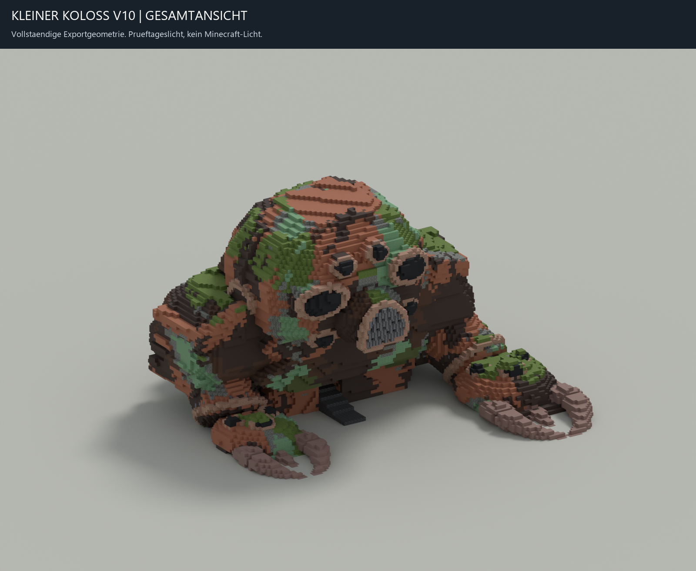
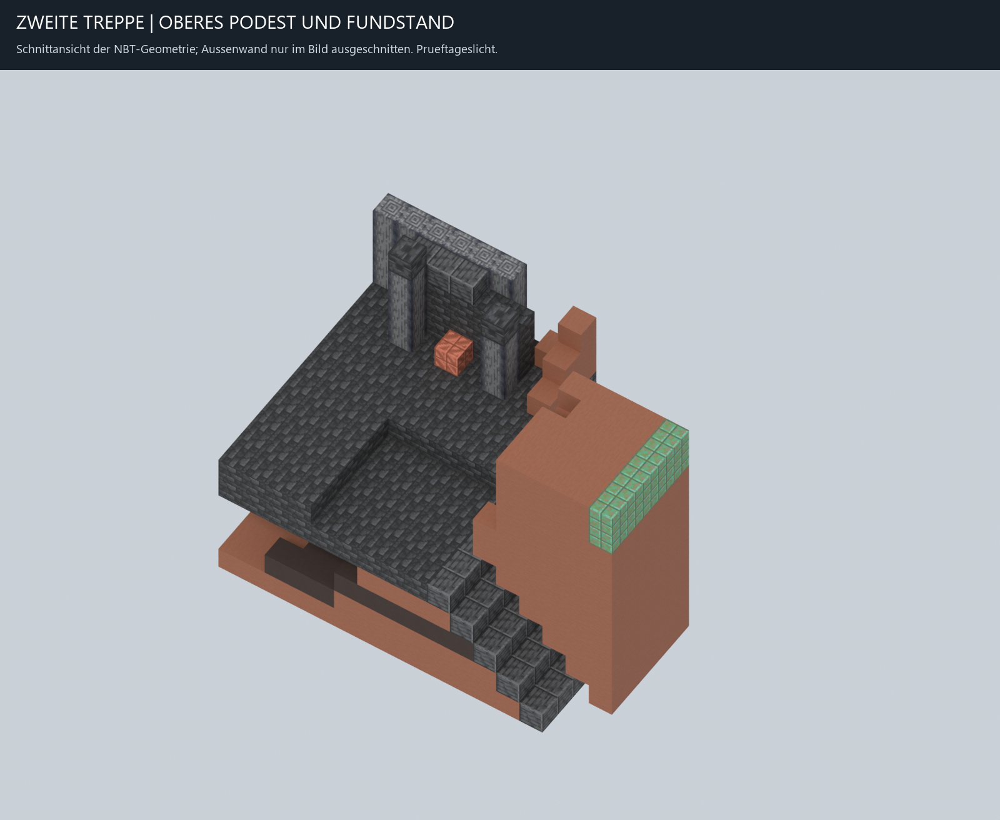
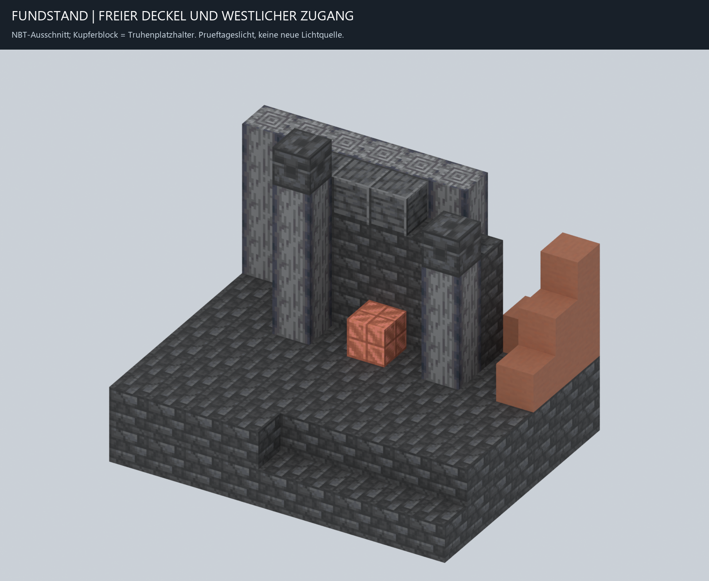

# Kleiner Koloss V10, Modellhandoff vom 28.10.2026

Status: **noch nicht runtime-integriert**. Nutzer-Sichtfreigabe steht aus. Kein Minecraft-Spieltest, keine natuerliche Generierung und kein finaler Spielerbuild durch diesen Worker.

## Modell und Form

Eigenstaendige Ableitung von `small-colossus-v9-interiors`, NBT SHA256 `565b8461b8aed3d4ab1bdca35859790b280d39167c970a80df96a2dab75d68c0`. Das V9-NBT, sein Sidecar und Design werden beim Ableiten geprueft. Masse 111 x 80 x 113, Ground-Y 13, DataVersion 3105 bleiben erhalten.

Der tatsaechliche grosse V7-Armstand wurde in `colossus-v7-landmarks/arm-review.png` angesehen. Der kleine Stand uebernimmt den offenen Zugang, den technischen Ruecken und Basaltpfeiler. Die Pfeiler enden unterschiedlich hoch, der Ruecken ist abgestuft. Kein Sitz, Bedienmechanismus, Licht, Spawner oder Vault wurde hinzugefuegt. Die vorhandene Rippe bei X69 bleibt hinter dem neuen Ruecken erhalten.

Die einzige Marker-ID `small-magnet-chest-1`, Rolle `small_magnet_chest`, steht jetzt bei **[67,44,53], facing west**, weiterhin mit `minecraft:waxed_cut_copper` als Platzhalter. Runtime muss ihn spaeter durch die native waxed_copper_chest ersetzen. Der alte Platzhalter [73,19,80] wurde entfernt, sein Boden [73,18,80] bleibt exakt erhalten. Insgesamt 28 hinzugefuegte Bloecke, ein entfernter Block, keine Remaps. Alle Aenderungen liegen am Stand X67..68/Y44..48/Z51..55 oder am alten Platzhalter. Aussenschale, Zerstoerung, Maschinenreste, beide Treppen und alle alten Boeden bleiben unveraendert.

## Zuwegung und Terrain

Die erste Treppe fuehrt von [62,14,40] nach [62,19,69]. Der Anschluss an [61,19,82], die zweite Treppe bis [61,43,58] und der weitere Weg bis zur Bedienposition [66,44,53] sind im Export geprueft. Der neue dokumentierte Weg biegt am vorhandenen Auslauf ueber [63,43,57] auf [64,44,57] ab. Der tragende Plattformboden liegt auf Y43. Es wurde kein alternativer Aufstieg gebaut.

Zusaetzlich zu den 57 alten Regionen sind zwei `small_interior_clearance`-Regionen im Sidecar:

- `small-interior-clearance-58`: [62,43,53] bis [66,47,58], Uebergang und Zugang.
- `small-interior-clearance-59`: [64,44,50] bis [68,50,56], Stand und Deckelraum.

Die Regionshuellen sind keine Aufforderung zum Loeschen von Quellbloecken. Runtime muss alle belegten NBT-Zellen abziehen. Das ist fuer Rahmen, Rippe, Boeden und Schale entscheidend. Die Quelle behaelt die bestehende allow-list; Root uebernimmt die begrenzte Erweiterung um native Overworld-Erze. Direkt ueber der Truhe sind Y45..50 frei und reserviert. Der westliche Bedienbereich X64..66/Z52..56 hat durchgehend Boden und mindestens drei freie Zellen Hoehe.

## Pruefungen

`build/distribution-venv/Scripts/python.exe -m unittest discover -s tests -p test_small_colossus_landmarks.py -v`: vier Tests bestanden. Der vorhandene Handoff-Validator besteht neun Pruefgruppen. NBT und Schematic wurden unabhaengig gelesen und verglichen; 33 Kacheln rekonstruieren das NBT verlustfrei. Native Blockstates wurden gegen beide vorhandenen 26.2-Registryreports validiert. 208038 Quellbloecke, eine Markerrolle und 59 Regionen.

Alle dokumentierten Wege haben mindestens drei Zellen Kopfraum, tragenden Boden und reservierte Terrain-Clearance. Zusaetzlich prueft die Wegsuche Eingang, unteren Anschluss, zweite Treppe und Truhenzugang zusammen. Sie ist eine konservative Voxelpruefung mit Einblockschritten, kein Minecraft-Physiktest. Vier rechnerische Drehungen pruefen Markerorientierung, Deckel-/Bedienfreiraum und die Trennung gerauemter Zellen von Quellgeometrie.

Die neue Blender-Datei wurde im Hintergrund erstellt und in einem frischen Blender-5.2-Prozess erneut geoeffnet. NBT-Hashbindung, 24 Blockstate-Meshes, Marker-Empty samt Koordinaten und 61 Flaechen der editierten Gruppe wurden gegen NBT-Voxel geprueft. Die vollstaendige editierbare Quelle enthaelt keine fuer Reviewbilder entfernten Waende. Der neue Stand ist als `upper-salvage-frame` gruppiert, die erhaltene Geometrie bleibt separat.

Vor Beginn der parallelen Crash-Reparatur wurden alle 1278 Dateien aus `model-baseline.json` unveraendert bestaetigt. Die Abschlusspruefung erlaubt ausschliesslich die vom Nutzer angekuendigten Root-Aenderungen an `NaturalInteriors.java`, `NaturalInteriorChecks.java` und `test_natural_interiors_server.py`; beobachtete Unterschiede stehen in `preservation.json`. Alle anderen Baseline-Dateien muessen unveraendert bleiben. Dieser Modellworker hat keine Java-, Runtime-, Rezept-, Ressourcen-, Welt-, Profil-, Ignore- oder Git-Attributaenderungen vorgenommen. Kein Commit/Push. Fundwurf von zehn Prozent, defekter Magnet, normale Materialien und Reparaturbuch bleiben unveraendert.

## Bilder und Dateien

Alle Artefakte liegen in `relics/colossus/design/generated/small-colossus-v10-landmarks/`.

Die Bilder zeigen die exportierte NBT-Geometrie. Die Kontextansicht schneidet auf X59..69/Y38..51/Z49..65 zu und zeigt fuer Z>57 nur X59..63, damit der Aufstieg sichtbar ist. Diese Schnittmaske betrifft ausschliesslich das Bild. Prueftageslicht ist Blender-Beleuchtung und keine behauptete Minecraft-Lichtquelle. Kupferblockdarstellung ist ein Platzhalter, keine native animierte Truhe. Die Ansichten wurden vom Worker visuell kontrolliert, nicht vom Nutzer freigegeben.

Generator: `tools/build_small_colossus_landmarks.py`. Renderer und frische Wiedereroeffnung: `tools/render_small_colossus_landmarks.py`, mit `-- --verify`. Abschluss: `tools/finalize_small_colossus_landmarks.py`. Regression: `tests/test_small_colossus_landmarks.py`.

Der vollstaendige Index `docs/project/reviews/small-colossus-landmarks-20261028-handoff.json` ersetzt ausschliesslich `assets.small_colossus` aus `colossus-landmarks-20261028-handoff.json`. Die vier anderen Eintraege bleiben als Daten identisch, einschliesslich aller 144 V7-Dateibindungen. SHA256 und Bytegroessen aller neuen Modellartefakte, Kacheln, Werkzeuge und dieses Berichts stehen im neuen Index.

Root muss fuer V10 eine neue Runtime-Revision anlegen und die bestehenden Revisionen fuer gespeicherte V9-Welten bewahren. Offen bleiben Runtime-Integration, Erz-Clearance in natuerlichem Terrain, native Deckelanimation, finaler Spielerbuild und Nutzer-Sichtfreigabe.

NBT SHA256: `7d88093eece8e8de1d8b8ca3e316ae516e8b5c6dcdfc20b50b8fc35586133db8`.

Blender SHA256: `be547535958ea46d10631f8cab7eb7bad48c86c2864cc198a5514fc82ab7b4c0`.
