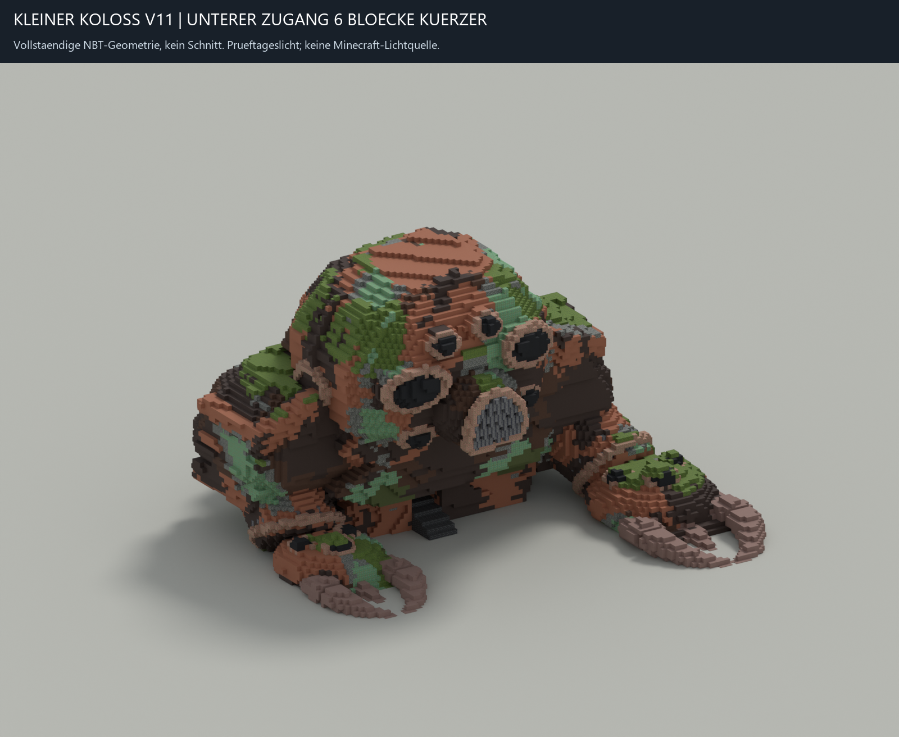
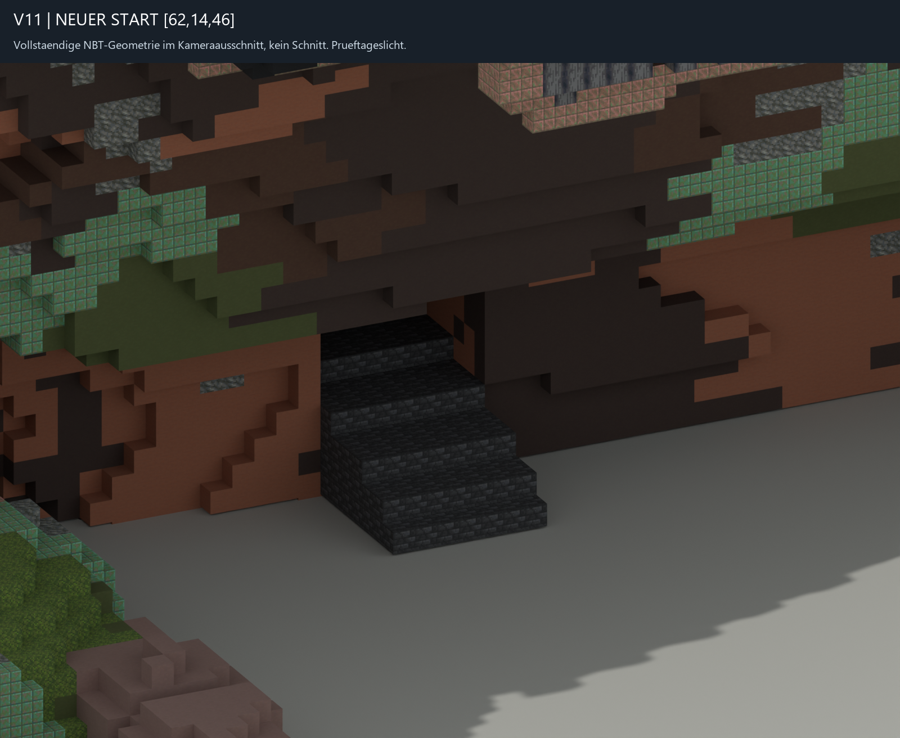
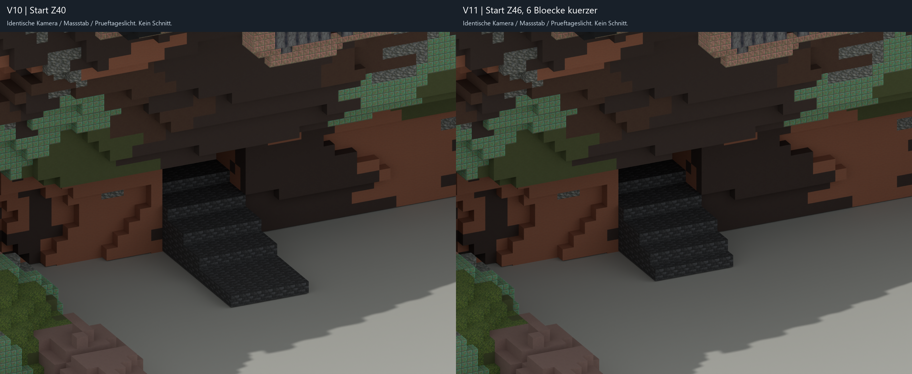

# Kleiner Koloss V11, verkuerzter unterer Eingang

Modellauftrag, noch nicht runtime-integriert; kleine Form weiterhin nicht vom Nutzer abgenommen. Runtime, Servertests und Testbuild folgen durch Root. Keine Welt-, Profil-, Java-, Ressourcen-, Katalog- oder Versionsauswahl-Aenderungen. Kein Commit/Push.

## Aenderung am exportierten Modell

Basis ist das tatsaechliche V10-NBT mit SHA256 `7d88093eece8e8de1d8b8ca3e316ae516e8b5c6dcdfc20b50b8fc35586133db8`. V10-Gesamtbild, exportierte Voxel und beide neuen Detailrender wurden kontrolliert. Die Aussenhuelle bleibt erhalten.

Der untere Zugangsweg wurde genau **sechs Bloecke** kuerzer: Beginn Z40 wird Z46. Neuer Fusswegstart **[62,14,46]**, Breite unveraendert X59..65. Entfernt sind 42 Bodenbloecke bei X59..65/Y13/Z40..45 und sieben Bloecke bei X59..65/Y14/Z46. Insgesamt 49 entfernte Bloecke, keine hinzugefuegten oder umgefaerbten Bloecke. Aenderungsgrenzen [59,13,40] bis [65,14,46]. Alle 49 Zellen waren im urspruenglichen Katalogmodell frei. Die alte Aussenhuelle wurde nicht angeschnitten. Auch seitlich bleibt kein Rest des langen Stegs.

Der neue erste Boden liegt Y13, die Fuesse Y14. Vom Nominalboden mit Fussniveau Y13 ist das ein Einblockschritt. Z47..48 haben Fussniveau Y15, Z49..51 Y16, Z52..54 Y17, Z55..57 Y18 und Z58..69 Y19. Der neue Eingang endet damit nicht an einer Zweiblockwand. Der erste Tritt hat fuenf freie Zellen nach oben, die gesamte gepruefte Route mindestens drei.

Unterer Raum, Rippen, Maschinenreste, zweite Wartungstreppe [61,19,82] bis [61,43,58] sowie oberer Truhenstand sind exakt V10. Truhenmarker `small-magnet-chest-1` bleibt [67,44,53], west, `minecraft:waxed_cut_copper`; Bedienpunkt [66,44,53]. Keine weiteren Marker, Truhen, Lichter oder Mechaniken.

## Terrain und Wege

Der Pfad `breast-rupture-entry` beginnt jetzt [62,14,46] und endet unveraendert [62,19,69]. Die anderen Designpfade bleiben identisch. Sechs `small_interior_clearance`-Regionen mit IDs `small-interior-clearance-3` bis `small-interior-clearance-8` fuer Z40..45 entfallen. Region `small-interior-clearance-9` wird von [59,15,46]..[65,19,46] auf [59,14,46]..[65,19,46] abgesenkt. Alle anderen Regionen bleiben exakt erhalten. Gesamtzahl 53 statt 59. Vor dem Einstieg bleibt keine niedrige Freiraummaske zurueck; die oberen Masken sind unveraendert.

Freiraummasken duerfen nur quellenfreie Zellen raeumen. Saemtliche NBT-Solids sind vor Anwendung abzuziehen, auch wenn sie innerhalb einer Regionshuelle stehen. Tests pruefen diese Trennung ueber alle Masken in vier rechnerischen Drehungen sowie die westliche Markerorientierung und den Deckel-/Bedienfreiraum.

## Nachweise

Fuenf eigene Regressionstests bestanden: `build/distribution-venv/Scripts/python.exe -m unittest discover -s tests -p test_small_colossus_short_entry.py -v`. Unabhaengiges Lesen von NBT und Schematic ergibt Gleichheit. 33 Kacheln rekonstruieren alle 207989 Bloecke verlustfrei. Masse 111 x 80 x 113, Ground-Y13 und DataVersion3105 unveraendert. Beide vorhandenen 26.2-Registryberichte wurden verwendet; der vorhandene Handoff-Validator besteht neun Pruefgruppen.

Eine eigene exakte Breitensuche prueft Nominalboden [62,13,45], Einstieg [62,14,46], unteren Raum [62,19,69], Treppenanfang [61,19,82], Treppenende [61,43,58] und Bedienpunkt [66,44,53]. Alle Ziele werden exakt erreicht, mit drei Zellen Kopfraum und maximal einem Block Hoehenunterschied. Der Nominalboden ist nur eine lokale Testfixture, kein hinzugefuegter Exportboden. Vollstaendige gefundene Wege stehen in `walk-verification.json`. Dies ist eine Voxelpruefung, kein Minecraft-Physik- oder Terrainspieltest.

Blender 5.2.2 lief unsichtbar im Hintergrund. Die gespeicherte editierbare Quelle wurde in einem frischen Prozess erneut geoeffnet. NBT-Hashbindung, 21 Meshes, alle 58168 Oberflaechen und das Marker-Empty stimmen mit einer vollstaendig neu aus NBT rekonstruierten Geometrie ueberein. Der abgesenkte Eintrittsboden liegt separat in `shortened-lower-entry`; uebrige Geometrie in `Preserved baseline`. Entfernte Voxel sind im Generator und Differenztest dokumentiert. Keine Wand wurde fuer die Kamera aus der Quelldatei entfernt.

Alle 1339 Dateien der Root-Baseline sind bytegleich. Der neue Handoff leitet sich vom vollstaendigen `small-colossus-landmarks-20261028-handoff.json` ab und ersetzt ausschliesslich `assets.small_colossus`. Vier andere Eintraege samt V7-Bindungen bleiben identisch. Bestehende Berichte und Exporte werden nicht ueberschrieben. Bericht, Werkzeuge, Tests, Bilder, Quelle und Exporte sind mit SHA256 und Bytegroessen gebunden.

## Bilder

Die Ansichten zeigen echte Exportgeometrie. Gesamtbild und Eingangsausschnitt enthalten keine Schnittmasken. Prueftageslicht und die Praesentationsbodenebene sind nur Renderhilfen. Der V10/V11-Vergleich verwendet dieselbe Kamera, denselben Massstab und dieselbe Beleuchtung. Die Bilder wurden vom Worker angesehen; keine Nutzerabnahme wird daraus abgeleitet.

## Uebergabe

Artefaktordner: `relics/colossus/design/generated/small-colossus-v11-short-entry/`. Generator, Renderer und Abschluss liegen unter `tools/*small_colossus_short_entry.py`; Tests unter `tests/test_small_colossus_short_entry.py`. Der Generator liest ausschliesslich V10 als direkte Modellbasis. Alle JSON-Ausgaben sind UTF-8/LF, Python-Dateien UTF-8 ohne BOM.

Offen fuer Root sind neue Runtime-Revision, Generierung, Servertests, Testbuild und Nutzer-Sichtabnahme. Bestehende gespeicherte V1/V2/V3-Daten bleiben eingefroren. Fundchance, defekter Magnet, Reparatur/Buch, Pro-Item-Verbrauch und Friedlich-Fix wurden nicht angefasst.

NBT SHA256: `77026f72aa37ec72ef3722f9750a56fa820c327192f42924b05029497951c707`.

Blender SHA256: `6205703af7c1ff890c73e21b89a58c6b8080e7e8979e75d41891182cd4706bc1`.
