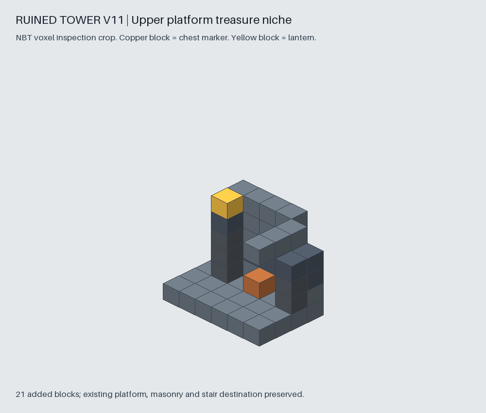
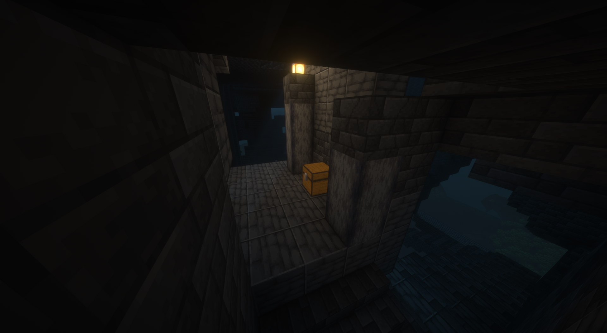

# Schatztruhe auf der oberen Turmplattform

Am 11. November 2026 beauftragt und mit Federfall IV bestätigt.

## Gestaltung und Belohnung

Auf der erhaltenen oberen Zielplattform des Aufstiegs steht eine kleine
verfallene Vorratsnische. Die Rückwand besteht aus rissigen Tiefenschieferfliesen
und poliertem Tiefenschiefer. Zwei unterschiedlich hohe Basaltpfeiler und eine
Laterne fassen die Truhe ein. Die Truhe steht bei `[73,174,56]`, Blickrichtung
Süden, direkt neben dem bisherigen Aufstiegsziel `[72,174,57]`.
Ihr Bedienplatz ist `[73,174,57]`; der vorhandene Boden liegt auf Y173.

Der neue Marker `tower-summit-chest-1`, Rolle `tower_summit_chest`, erhält
unabhängig von der unteren Truhe genau diesen Inhalt:

- Ein verzaubertes Buch mit Federfall IV, über die native gespeicherte Verzauberung.
- 3–6 Diamanten, jeweils einschließlich der Grenzen.
- 8–16 Eisenbarren, jeweils einschließlich der Grenzen.

Die Befüllung nutzt die vorhandene einmalige Aktion pro Standort und Marker.
Inhalte und abgeschlossene Aktion werden gemeinsam im besitzenden Chunk
persistiert. Die untere Truhe behält ihre eigene Aktion und ihren bisherigen
Enderloot. Beide verwenden dieselbe native Truhenart wie die anderen Relikte;
auf älteren Spielversionen übernimmt der bestehende Adapter die normale Truhe.

## Modell und Bestandsschutz

Quelle ist das unveränderte V10-Modell. V11 fügt 21 Blöcke hinzu. Kein
vorhandener Block wird entfernt oder ersetzt. Maße `111 × 232 × 93`, Ground-Y 12,
Außenform, Enderman-Marker, untere Truhe, Aufstiegsziel und Treppenlücken bleiben
unverändert. Die Ergänzungen stehen auf dem bereits vorhandenen Plattformboden.
Freiraum vor der Truhe und über ihrem Deckel ist für alle vier Rotationen geprüft.
Eine begrenzte zusätzliche Freiraumregion schützt den Zugang vor nativem Terrain,
wobei sämtliche belegten Modellzellen von der Räumung abgezogen werden.

Die neue Innenraumrevision lautet `interiors-20261111-v6`. Alle bisherigen
Revisionen einschließlich V5 und ihrer Vorlagen bleiben erhalten. Neue Welten
wählen V6; gespeicherte Welten behalten ihre eingefrorene Auswahl, auch für
weitere Chunks. Es findet keine nachträgliche Platzierung in bestehenden Türmen
statt. Verteilungseinstellungen und Standortalgorithmen werden nicht geändert.

## Dateien und Prüfungen

- Modellquelle und Export:
  [V11-Ordner](../../relics/ruined-tower/design/generated/ruined-tower-v11-upper-chest/).
- Reproduzierbarer Modellbau: [build_tower_upper_chest.py](../../tools/build_tower_upper_chest.py).
- [Modellprüfung](../../tests/test_tower_upper_chest.py) mit Bestandsschutz,
  Zugang, Deckel, vier Rotationen, Schematic/NBT-Gleichheit, Kacheln und
  Auswahl der neuen Vorlage bei unveränderten älteren Revisionen.
- [Native Block-Registrierung](reviews/tower-upper-chest-20261111-registry.json)
  für die zusätzliche Laterne, direkt aus dem offiziellen 26.2-Server abgefragt.
- NBT-SHA256: `fd3a1c9c7cbef6f5c7665ecac3c49f9faef33540237a87907b7ac0d908029b39`.

Vier neue Modellprüfungen und alle neun bestehenden Prüfungen der
Innenraum-Integration bestehen. Der Handoff-Validator besteht neun Prüfgruppen.
Der [Bestandsvergleich](../testing/tower-upper-chest-preservation-20261111.json)
prüft 230 vorhandene Ressourcen und V10-Modelldateien. 229 bleiben bytegleich
zum ersten Prüfstand; die Mixinkonfiguration wird unverändert aus dem
PR-3-Vorgänger übernommen. Die Turmerweiterung verändert keine dieser
bestehenden Dateien. Auch die sechs Verteilungsalgorithmen sind bytegleich
zum PR-3-Vorgänger. Die Fabric-Spielerbuilds für 26.2 und 1.21.1 bestehen einschließlich
Ressourcengraph, Java-Kompilation und für 1.21.1 Remapping und Assetprüfung.
Die zusätzliche remappte Prüf-JAR für 1.21.1 kompiliert ebenfalls.
Der [native Testbeleg](../testing/tower-upper-chest-native-20261111.json)
enthält drei saubere Fabric-26.2-Serverläufe mit Exitcode 0 und ohne ERROR-
Einträge. Der Turm wird per `/locate` gefunden und mit dem echten Planer
abgeglichen. Seine komplette Grundfläche von 63 Chunks wird natürlich generiert.
Beide nativen Truhen haben die erwartete Ausrichtung und freien Deckelraum.
Die obere enthält im geprüften Standort Federfall IV, fünf Diamanten und
13 Eisenbarren, die untere sechs Enderperlen. Der Inhalt bleibt nach dem
ersten Neuladen exakt gleich. Danach werden beide Truhen entfernt; beim
zweiten Neuladen werden sie nicht erneut erzeugt. Die Journalbytes bleiben
bei beiden Neustarts identisch. Native Rotation dieses Standorts ist 0;
alle vier Rotationen sind zusätzlich geometrisch geprüft.

Reproduktion mit vorhandenen Prüfabhängigkeiten und akzeptierter Minecraft-EULA:

```sh
python3 tools/test_tower_upper_server.py --accept-eula \
  --java-home /path/to/jdk-25 --artifact /path/to/fabric-26.2.jar
```

Der Test verwendet eine neue isolierte Welt und übernimmt keine Spielerprofile.
Der Test für Survival-Balance bleibt separat. Die grafische Abnahme im Spiel
ist durch den Autor am 11. November 2026 bestätigt, siehe unten.



Das Bild ist ein NBT-Inspektionsausschnitt. Kupfer markiert den später durch die
native Truhe ersetzten Platzhalter; der gelbe Würfel markiert die Laterne.
Es ist keine Minecraft-Aufnahme und kein Nachweis nativer Beleuchtung.

## Visuelle Abnahme durch den Autor

Am 11. November 2026 bestätigt der Autor nach seinem Spieltest: „der turm passt
übrigens“. Die fünf zugehörigen Shaderaufnahmen zeigen die obere Plattform,
die eingebaute Truhe, den Zugang und die Laterne im tatsächlichen Turm. Damit
ist die visuelle Integration der Truhennische abgenommen. Die Bilder zeigen
kein Inventar und liefern keinen zusätzlichen Nachweis für Loot-Inhalte oder
Survival-Balance.

Die [Originalaufnahmen](../images/screenshots/originals/tower-upper-chest-20261111/)
sind unverändert archiviert; der [Abnahmebeleg](../testing/tower-upper-chest-author-review-20261111.json)
enthält Maße und SHA256-Werte. Laufzeitvorlagen und gespeicherte Auswahlverträge
werden durch diese Dokumentation nicht geändert.


