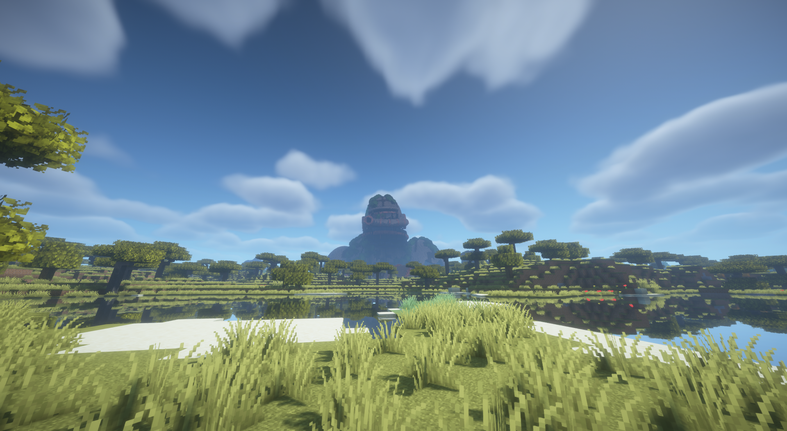
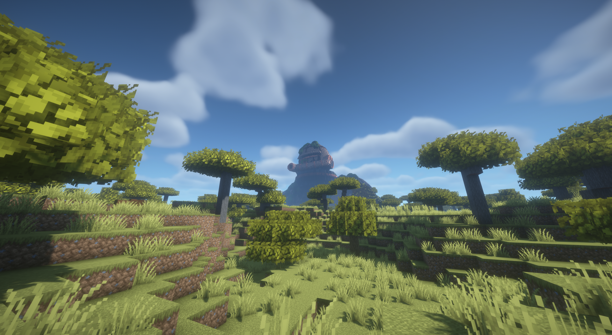
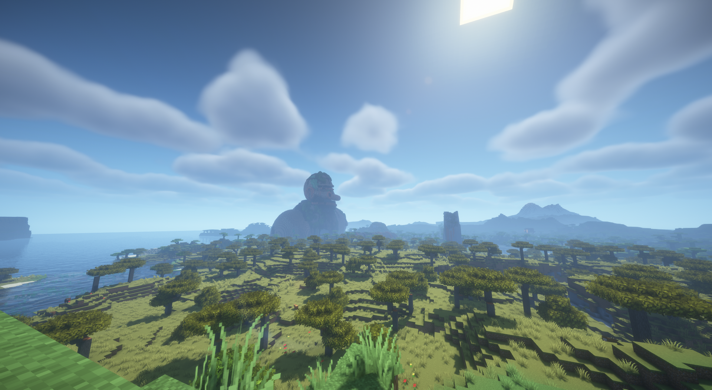

# CurseForge publication draft

Prepared 5 November 2026. Intended configuration for review. The user supplied
project ID `1785231` on 6 November. The upload token is configured locally and
in GitHub Actions. The author API has now accepted all four `1.0.0-beta.1`
uploads to this project and returned file IDs. Public downloads and moderation
approval are not established by upload acceptance. The dashboard page remains
unverified because browser access is blocked. See the
[publication record](BETA_1_0_0_PUBLICATION.md) and
[platform API access](../technical/PLATFORM_ACCESS.md). The user also supplied
https://www.curseforge.com/minecraft/mc-mods/titan-relics/preview. An anonymous
check returned a 404 page; project settings, ownership and moderation status could
not be independently verified. The project-page fields and description below are not a verified
copy of the platform. The selected name is Titan Relics and the license is MIT.
Public beta approval remains pending. The [shared preparation checklist](PUBLIC_BETA_PREPARATION.md) applies.
The repository is now public at https://github.com/Auda29/Titan-Relics.
The source, player documentation and issue tracker use that public destination.

## Proposed project fields

| Field | Draft value |
|---|---|
| Game / class | Minecraft Java Edition / Mods |
| Name | Titan Relics |
| Tagline | Colossal ruins of a forgotten age |
| Slug / preview URL | `titan-relics`; https://www.curseforge.com/minecraft/mc-mods/titan-relics/preview, supplied by the user, anonymous check returned 404 |
| Project ID | `1785231`, supplied by the user; four file uploads accepted; dashboard settings unverified |
| Summary | Explore colossal ruins, uncover archaeology and follow expedition maps to recover ancient machinery. |
| Main category | World Gen; confirm current portal options |
| Additional categories | Structures; Adventure and RPG, if available and appropriate |
| License | MIT; retain the copyright and license notice |
| Source | https://github.com/Auda29/Titan-Relics |
| Issues | External tracker: https://github.com/Auda29/Titan-Relics/issues |
| Wiki | https://github.com/Auda29/Titan-Relics/blob/main/docs/players/PLAYER_GUIDE.md |
| Logo | Prepared 400 × 400 Colossus screenshot icon in `assets/branding/titan-relics-icon.png`; interim V3 model |
| Title image / screenshots | Original V3 shader captures, river view first; [files and captions](../../assets/branding/README.md); dashboard upload still required |
| Distribution / modpack permissions | Permitted under MIT; platform distribution settings still need review |

## Description draft

*Colossal ruins of a forgotten age*

*In-game shader capture, 1 October 2026. Earlier Colossus V3 model; interim preview.*

Discover the remains of an age of giants. Titan Relics adds monumental structures
to Minecraft's Overworld: abandoned colossi, weathered obelisks, titan skulls,
a World Tree and a ruined tower.

Bring a brush to investigate archaeological remains, follow recovered expedition
maps and search ancient machinery. Recover a rechargeable Machine Core for
furnaces, blast furnaces and smokers, or use a repairable Salvage Magnet to gather
nearby dropped items while held. Each landmark offers part of a history that the
landscape never fully explains.

### In-game screenshots

*In-game shader capture, 1 October 2026. Earlier Colossus V3 model; interim preview.*

*In-game shader capture, 1 October 2026. Earlier Colossus V3 model; interim preview.
Other visible structures are not identified as Titan Relics assets.*

### World settings

Select Expedition, Balanced or Discoveries before creating a world. You can also
edit distances, family shares and biome rules. Worlds retain their saved settings,
including in unexplored chunks. Suitable terrain may be far away, so minimum
distances are not maximum journey lengths. Expedition maps share the same unique
large Colossus destination in a supported world.

### Requirements

Use the file matching both your Minecraft version and loader:

- Minecraft 1.21.1: Java 21, Fabric or NeoForge.
- Minecraft 26.2: Java 25, Fabric or NeoForge.
- All targets need the matching Lithostitched 1.8.0 build.
- Fabric targets additionally need the matching Fabric API. NeoForge targets do not.

Install the mod and dependencies on the server and every player client. A new
world with structures enabled gives the complete current selection. The 1.21.1
builds use ferns and ordinary chests instead of unavailable 26.2 blocks.

### Status and support

Beta 1.0.0 is the first public testing release. The author has approved release
before the full natural Survival playthrough, which will use this beta. Survival
balance and discovery pacing remain under review. Shared archaeology and ordinary
containers are finite; updates and later visitors do not refill them. Back up
worlds before changing mods or datapacks. Frozen plans are not automatically
migrated to a different modpack setup.

DH 3.3.3 FEATURES can omit relics in distant generation; INTERNAL_SERVER passed
for new distant generation. Large Voxy pregeneration settings, old LOD-cache
repairs and long-term FPS/memory behavior remain unverified. Compatibility
evidence applies to the documented setups and versions.

Read the [installation instructions](https://github.com/Auda29/Titan-Relics/blob/main/docs/players/INSTALLATION.md),
[player guide](https://github.com/Auda29/Titan-Relics/blob/main/docs/players/PLAYER_GUIDE.md)
and [compatibility notes](https://github.com/Auda29/Titan-Relics/blob/main/docs/technical/MOD_COMPATIBILITY.md).
Submit bugs through the [issue tracker](https://github.com/Auda29/Titan-Relics/issues/new/choose)
with exact versions, logs and steps to reproduce.

### License and modpacks

Titan Relics is licensed under the [MIT License](https://github.com/Auda29/Titan-Relics/blob/main/LICENSE).
Modpacks, modifications and redistribution, including commercial use, are allowed
under MIT with the copyright and license notice retained. No individual modpack
permission request is needed. Third-party works and visual references retain
their own rights; this license does not grant rights to the referenced artworks.

### Inspirations and credits

Development used generative AI assistance for code, asset-generator scripts and
documentation. The page images are original in-game shader captures; the icon
is a crop of one capture. Their older V3 model date is identified in the captions.

Titan Relics draws visual inspiration from
[The Archive In Between](https://www.instagram.com/thearchiveinbetween/),
especially its overgrown colossi, titan remains and monumental trees.
The Obelisk and Ruined Tower also draw on references by Josh White.
The icon and interim images use the author's in-game shader captures of the large
Colossus, showing the earlier V3 model. Minecraft and shader assets retain their own rights.
See the [credits and original reference links](https://github.com/Auda29/Titan-Relics/blob/main/CREDITS.md).

## File settings at release

Upload each of the four JARs in the
[shared matrix](PUBLIC_BETA_PREPARATION.md#gemeinsame-dateizuordnung) as its own
Minecraft mod file. Do not wrap the mod JAR in a modpack ZIP. Each file gets only
its actual game version and loader, a distinct display name such as
`Titan Relics VERSION / NeoForge / Minecraft 26.2`, **Beta** release type and the final
release notes. Keep automatic publication disabled until explicit approval.

Add [Lithostitched](https://www.curseforge.com/minecraft/mc-mods/lithostitched)
as a required related project on all four files and
[Fabric API](https://www.curseforge.com/minecraft/mc-mods/fabric-api) only on
Fabric files. Verify matching dependency files and available game-version tags
in the portal before upload. No project IDs are invented in this draft.

The official [submission guide](https://support.curseforge.com/support/solutions/articles/9000197241-creating-and-submitting-a-project)
requires English titles/descriptions and explains that a file upload enters
moderation. It also documents launcher visibility limits for beta-only projects.
Keep the truthful Beta classification and confirm current visibility behavior
before announcing launcher installation. Moderation acceptance is not guaranteed.

Before submission, check name availability and platform distribution settings, replace the draft
status paragraph with the approved state and verify public documentation links.
Review the current [submission tips](https://support.curseforge.com/support/solutions/articles/9000199552-project-submission-guide-and-tips)
and [moderation policies](https://support.curseforge.com/support/solutions/articles/9000197279-moderation-policies).
