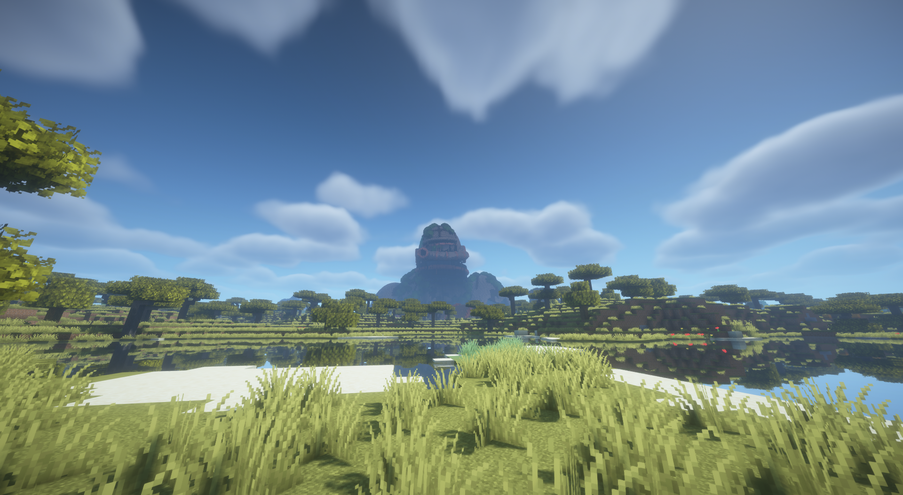

# Modrinth publication draft

Prepared 5 November 2026. Local review copy only. Selected title: Titan Relics.
Update 6 November: authenticated API access confirms project ID `F6QDr5Vr`,
title `Titan Relics` and status `draft`. The project has now been configured
through the API: MIT, description, source/wiki/issues links, adventure/worldgen
categories, game-mechanics as an additional category and the Colossus screenshot icon.
At the user's request, the three original V3 shader captures are the interim
gallery, with the river view featured and also used as the description's title image.
All written fields were read back. Status remains draft with zero versions;
no review submission or version upload occurred. Access details are in
[platform API access](../technical/PLATFORM_ACCESS.md).
The user supplied the project URL https://modrinth.com/project/titan-relics.
The earlier anonymous check returned "Project not found"; the later authenticated
check above supersedes that visibility limit for the fields actually read. The fields and description
below remain the intended configuration, not a verified copy of the platform. See the
[publication checklist and platform eligibility issue](PUBLIC_BETA_PREPARATION.md).
The repository is now public at https://github.com/Auda29/Titan-Relics.
The source, player documentation and issue tracker use that public destination.

## Proposed project fields

| Field | Draft value |
|---|---|
| Title | Titan Relics |
| Tagline | Colossal ruins of a forgotten age |
| Slug / project URL | `titan-relics`; https://modrinth.com/project/titan-relics; authenticated draft ID `F6QDr5Vr` |
| Project type | Mod |
| Summary | Explore colossal ruins, uncover archaeology and follow expedition maps to recover ancient machinery. |
| Categories | Adventure, World Generation; confirm available portal labels |
| Environment | Required on client and server |
| Source | https://github.com/Auda29/Titan-Relics |
| Issues | https://github.com/Auda29/Titan-Relics/issues |
| Wiki | https://github.com/Auda29/Titan-Relics/blob/main/docs/players/PLAYER_GUIDE.md |
| License | MIT; retain the copyright and license notice |
| Icon/gallery | 400 × 400 Colossus screenshot icon; three interim V3 shader captures, river view featured; see [image sources and captions](../../assets/branding/README.md) |
| AI content disclosure | Required for these AI-assisted page drafts; production eligibility still needs separate assessment |

## Description draft

*Colossal ruins of a forgotten age*

*In-game shader capture, 1 October 2026. Earlier Colossus V3 model; interim preview.*

Explore the remains of a world built on a different scale. Titan Relics adds
monumental discoveries to the Overworld: abandoned colossi, weathered obelisks,
titan skulls, a World Tree and a ruined tower.

Investigate archaeological remains with a brush, recover expedition maps and
explore the machinery left behind. A rechargeable Machine Core powers vanilla
furnaces, blast furnaces and smokers. A repairable Salvage Magnet gathers nearby
drops while held. The relics share a history, but much of it is left for you to
interpret.

### Choose your expedition

Choose Expedition, Balanced or Discoveries when creating a world, or edit
distances, family shares and biome rules. Those choices remain saved with that
world. Relics can be far apart; spacing and minimum-distance settings do not
promise a find within a particular travel distance. There is one unique large
Colossus in a supported world, and expedition maps share that destination.

### Installation

Choose the file for your exact game version and loader. Targets are Fabric and
NeoForge on Minecraft 1.21.1 and 26.2. Java 21 is required for 1.21.1, Java 25 for
26.2. Fabric also requires Fabric API. All targets require the matching
Lithostitched 1.8.0 build. Install the mod and dependencies on both server and
player clients. Start a new world with structures enabled for the full selection.

Read the [installation guide](https://github.com/Auda29/Titan-Relics/blob/main/docs/players/INSTALLATION.md)
and [short player guide](https://github.com/Auda29/Titan-Relics/blob/main/docs/players/PLAYER_GUIDE.md).

### Before you download

This is a beta-page draft; a public beta has not been released. The full natural
Survival playthrough is still awaiting acceptance. Existing worlds keep their
saved plans, including for new chunks; updates do not refill old shared loot.
Back up saves before changing a modpack. The 1.21.1 builds use ferns and ordinary
chests in place of unavailable 26.2 blocks.

DH 3.3.3 FEATURES can omit relics during distant generation. INTERNAL_SERVER is
the tested path for new distant generation. Old incomplete LOD-cache repair,
all-modpack compatibility and long-term FPS/memory guarantees are not offered.
See the [tested combinations and limits](https://github.com/Auda29/Titan-Relics/blob/main/docs/technical/MOD_COMPATIBILITY.md).

Report bugs with exact versions, reproduction steps and logs through the
[issue tracker](https://github.com/Auda29/Titan-Relics/issues/new/choose).

### License and modpacks

Titan Relics is licensed under the [MIT License](https://github.com/Auda29/Titan-Relics/blob/main/LICENSE).
Modpacks, modifications and redistribution, including commercial use, are allowed
under MIT with the copyright and license notice retained. No individual modpack
permission request is needed. Third-party works and visual references retain
their own rights; this license does not grant rights to the referenced artworks.

### Inspirations and credits

Titan Relics draws visual inspiration from
[The Archive In Between](https://www.instagram.com/thearchiveinbetween/),
especially its overgrown colossi, titan remains and monumental trees.
The Obelisk and Ruined Tower also draw on references by Josh White.
The icon and interim images use the author's in-game shader captures of the large
Colossus, showing the earlier V3 model. Minecraft and shader assets retain their own rights.
See the [credits and original reference links](https://github.com/Auda29/Titan-Relics/blob/main/CREDITS.md).

## Version settings at release

Use the four rows in the [shared file matrix](PUBLIC_BETA_PREPARATION.md#gemeinsame-dateizuordnung)
as **four separate versions**, each with one player JAR, one game version and one
loader. Use the chosen shared beta version number and distinguish target display
names, for example `Titan Relics VERSION / Fabric / Minecraft 1.21.1`. Release type is
Beta; do not advertise a stable release to gain launcher visibility.

For each Fabric version, add required dependencies on
[Fabric API](https://modrinth.com/mod/fabric-api) and
[Lithostitched](https://modrinth.com/mod/lithostitched). NeoForge versions require
only Lithostitched from this pair. Resolve the exact compatible dependency version
IDs at upload time against the pinned matrix; none are guessed here. Do not use
"additional files" for the other loader or game target.

Before pasting the description, replace its draft/release-status paragraph with
the approved release state, retain the MIT license/modpack statement, confirm all
links resolve publicly and complete provenance/platform review. Read the current
[Modrinth content rules](https://modrinth.com/legal/rules) again at submission.
