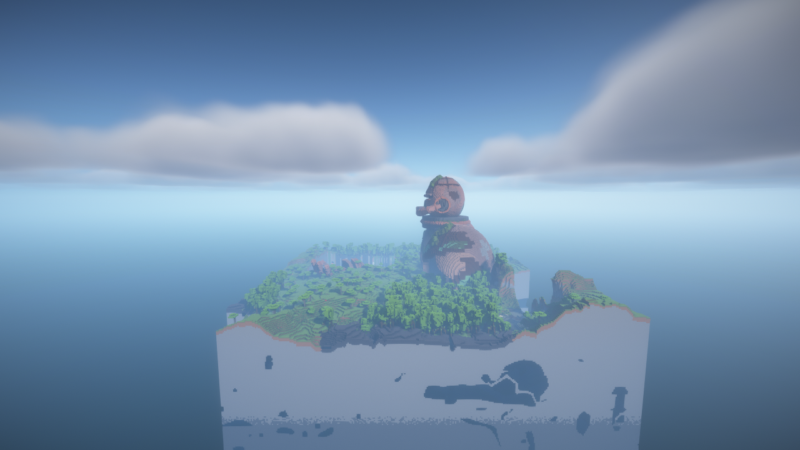

# Beta Punkt 5: Kompatibilität und Leistung

Stand: 4. November 2026. Die im [Prüfplan](BETA_COMPATIBILITY_PLAN_20261104.md)
festgelegte lokale Abnahme ist abgeschlossen. Alle 16 ausgewählten Serverläufe
halten ihre Budgets ein. Acht Modpack-Clientläufe und eine separate DH-Fernansicht
bestanden. Die Freigabe gilt für die unten beschriebenen Bedingungen;
DH-FEATURES ist für Reliktvorschauen weiterhin eingeschränkt.

Es wurden keine Produktionsdateien geändert, keine Originalprofile umgestellt
und kein Release erstellt. Geprüft wurden die vier unveränderten lokalen
5.0.5-Kandidaten aus der Clientabnahme mit Weltladeschutz und Discovery-Vorgabe.
Gleiche Versionsnamen bedeuten nicht, dass diese Dateien bereits veröffentlicht
oder in den Nutzerprofilen installiert sind.

Die [JSON-Evidenz](beta-compatibility-20261104.json) enthält Messphasen,
Budgetprüfungen, JAR-/Eingabehashes, originale Profilinventare, gespeicherte
Biome und Strukturstarts sowie die Bindungen der aufbewahrten Screenshots.
Rohwelten und vollständige Konsolen liegen unter
`E:/Relic_Mod_QA/compatibility-20261104/`. Diese lokalen Pfade sind keine Downloads.

## Verfahren und Grenzen

Hardware: AMD Ryzen 9 7900 und NVIDIA GeForce RTX 4060. Java 21 für 1.21.1,
Java 25 für 26.2; vier aktive Java-Prozessoren und maximal 4 GiB Heap pro Prozess.
Alle Tests liefen seriell; Clients waren stumm. Neue Welten, Laufzeitkopien
und temporäre Dateien lagen auf E:.

Jedes A/B-Paar verwendet dieselbe Chunkroute und denselben Seed, einmal mit
Relic und einmal ohne. Nach 64 Aufwärmchunks wurden 256 weitere Chunks angefordert.
Die Probe wartet auf tatsächlich geladene Chunks. Für beide Modpacks wurden
zwei Seeds geprüft: 731204 und 731205, mit umgekehrter A/B-Reihenfolge beim zweiten.
Die vier einfachen Loaderziele verwenden Seed 731204.

Die ersten Modpack-Paare umfassen zusätzlich die gesamte Bounding Box des
geplanten großen Kolosses in sechs Abschnitten zu je 64 angeforderten Chunks
und zwei anschließende Abschnitte zu je 256 Chunks: insgesamt 1.216 angeforderte
Chunks je Lauf. Durch Nachbarchunks und Zwischenstadien werden mehr Chunks
gespeichert. Angeforderte Chunks und gespeicherte Chunkdatensätze sind verschiedene
Messgrößen. Kein `/place` wurde als natürliche Generierung gewertet.

Die künstlichen Sammelanforderungen erzeugen lange Ticks, auch ohne Relic.
Die Abnahme behauptet keine 20 TPS während solcher Generierung. Idle-Messungen
nach Abschluss und belastete Phasen sind in der Evidenz getrennt ausgewiesen.
Die Stichprobe ist kein FPS-, Langzeit- oder Speicherlecknachweis.

## Vergleichsmessungen

Zeit bis zur Fertigstellung des gewöhnlichen Abschnitts mit 256 Chunks.
RSS ist der höchste beobachtete Prozessspeicher im gesamten jeweiligen Lauf,
nicht der Speicher dieses einzelnen Abschnitts. Modpack-Läufe auf Seed 731204
enthalten die zusätzliche Koloss-/Vorabgenerierungslast.

| Umgebung | Seed | Ohne Relic, s | Mit Relic, s | RSS ohne, GiB | RSS mit, GiB |
|---|---:|---:|---:|---:|---:|
| Fabric 26.2 | 731204 | 5,641 | 5,641 | 1,22 | 3,20 |
| NeoForge 26.2 | 731204 | 5,860 | 5,843 | 0,95 | 3,15 |
| Fabric 1.21.1 | 731204 | 6,485 | 6,485 | 1,41 | 3,00 |
| NeoForge 1.21.1 | 731204 | 6,328 | 7,125 | 1,28 | 3,51 |
| TerraVista | 731204 | 19,844 | 21,500 | 2,25 | 3,19 |
| TerraVista | 731205 | 10,141 | 10,141 | 1,98 | 3,35 |
| TerraVista Living World | 731204 | 20,875 | 22,422 | 3,98 | 4,16 |
| TerraVista Living World | 731205 | 13,640 | 13,891 | 3,10 | 3,65 |

[Interaktiver Vergleich](beta-compatibility-20261104.html).
Über die zwei geprüften Seeds beträgt der mittlere Zeitaufschlag etwa 5,5 %
für TerraVista und 5,2 % für Living World. Diese Mittelwerte erlauben keine
allgemeine Aussage zu anderen Seeds oder Hardware.

Der zusätzliche Speicherbedarf ist deutlich: In den einfachen Setups steigt
der beobachtete RSS-Höchstwert von 0,95–1,41 auf 3,00–3,51 GiB. Das bestandene
4-GiB-Heap-Budget bedeutet weder geringen Speicherverbrauch noch einen
4-GiB-Gesamtbedarf. Living World erreicht mit Relic 4,16 GiB RSS;
nativer Speicher kommt zum Java-Heap hinzu. Eine Ursache oder dauerhafte
Speicherbelegung wird aus diesen Spitzenwerten nicht abgeleitet.

Alle ausgewählten Prozesse endeten mit Code 0. Startup-, Abschnitts-,
Heap- und Idle-Grenzen bestanden. Jeder Lauf enthält mindestens 200 Idle-Ticks;
die mit Relic gemessenen Idle-Mittel liegen unter 0,9 ms und die p95-Werte
unter 5,2 ms. Einzelne lange Ticks und sämtliche belasteten Phasen bleiben
im JSON sichtbar. Die sechs Kolossabschnitte benötigen mit Relic in TerraVista
1,44–8,25 s, in Living World 1,88–10,17 s; alle bleiben innerhalb des
vorab vereinbarten Aufschlags gegenüber ihrer jeweiligen Kontrolle.

## Terrain, Biome und andere Strukturen

Die gespeicherten Weltmetadaten bestätigen aktive Tectonic-, Terralith-,
Biomes-O'-Plenty- und Dungeons-&-Taverns-Datenpakete. Die Auswertung der
vollständigen Chunks findet 32 unterschiedliche Biome in TerraVista und 37
in Living World. Biome werden über gespeicherte Paletten gezählt, nicht als
Flächenanteil oder allgemeine Verteilungsgarantie.

Beide erweiterten Modpack-Welten enthalten einen gültigen natürlichen
`relics:colossus`-Start mit der Bounding Box des eingefrorenen Plans.
Daneben existieren unter anderem `terralith:underground/old_refinery`,
Vanilla-Mineshafts und Trial Chambers sowie fremde `nova_structures`-Starts:
in TerraVista etwa Catacomb und Cave Chamber Dungeon Colony, in Living World
Wild Ruin und Bunker. Alle ausgewerteten gespeicherten Chunkdatensätze waren
lesbar. Das belegt gemeinsames Erzeugen in diesen Stichproben, keine
Kollisionsfreiheit aller denkbaren Seeds oder Strukturen.

## Grafik- und Jahreszeitenprüfungen

| Kopie / Variante | Tatsächlich geprüft | Ergebnis |
|---|---|---|
| TerraVista wie installiert | Voxy + Iris + BSL | Bestanden |
| TerraVista ohne Voxy und dessen World-Gen-Addon | Iris + BSL | Bestanden |
| TerraVista ohne Shader | Voxy, Iris ohne aktives Shaderpaket | Bestanden |
| Living World wie installiert | DH + Serene Seasons + SSDH + BSL, Winter | Bestanden |
| Living World ohne SSDH | DH + Serene Seasons + BSL, Winter | Bestanden |
| Living World ohne SSDH und Shader | DH + Serene Seasons, Winter | Bestanden |
| Living World ohne Seasons und dessen Brücke | DH + BSL | Bestanden |
| Living World wie installiert, Prozessneustart | Dieselbe zuvor gespeicherte Winterwelt erneut laden | Bestanden |

Die acht tatsächlichen Weltansichten wurden angesehen; die Original-PNGs
stehen unter [images/beta-compatibility-20261104](images/beta-compatibility-20261104/).
Iris meldet in jeder Variante den erwarteten Shaderzustand. Der Winterzustand
wurde über die Saison-API geprüft. Es wurden keine fehlenden Texturen oder
leeren Renderbilder festgestellt. Dies ersetzt keine vollständige visuelle
Prüfung jedes Fremdmodblocks.

DH-Ferngenerierung war für diese isolierten Grafikvergleiche ausgeschaltet.
Der Voxy-Generator wurde in den Testkopien auf Radius 8 Chunks, zwei Aufgaben
und eine Warteschlange von 512 begrenzt. Die Nutzerwerte wurden nicht geändert.
Damit ist keine Leistungsfreigabe für den originalen Radius 192 und sechs
gleichzeitige Aufgaben verbunden. Separate DH-Tests folgen unten.

Der frühere Nutzerbefund „ohne Adapter lädt es besser“ bleibt als historische
Beobachtung gültig. Aktuell ist `SSDH 1.0.3+terravista.dh3.1` wieder aktiv.
Die kurze Winter-/Neustartprüfung reproduziert damit keinen Absturz.
Das beweist weder die Unbedenklichkeit aller Adapterversionen noch einen
Fehler von Serene Seasons selbst.

## Distant Horizons: Ursache und funktionierender Weg

Ein echter DH-3.3.3-Generatorauftrag wurde vor dem normalen Spielerbesuch
auf einen bekannten, gültigen Kolossstandort angewendet:

| Modus | Native Callback-Chunks | Ergebnis |
|---|---:|---|
| FEATURES | 4 | Vanilla-Mineshaft vorhanden, geplanter Koloss fehlt |
| INTERNAL_SERVER | dieselben 4 | Gültiger `relics:colossus`-Start vorhanden |
| INTERNAL_SERVER, vollständiger Bereich | 324 | Kolossdaten erzeugt, Auftrag in 11,79 s beendet |

Damit ist die Einschränkung keine pauschale Unfähigkeit von DH, Strukturen
zu erzeugen. Die geprüfte FEATURES-Ausführung ruft Strukturstarts direkt
auf und umgeht den normalen Chunk-Task, in dem Relic seinen zulässigen
Verteilungskontext setzt. Relics Platzierungsprüfung lehnt den Start dann ab.
INTERNAL_SERVER durchläuft den regulären Weg.

Eine zusätzliche echte Clientansicht liest die so vorbereiteten Chunkdaten
mit DH `PRE_EXISTING_ONLY`. Der Koloss ist aus 400 Blöcken sichtbar, während
die Vanilla-Sichtweite zwei Chunks beträgt und der Zielchunk laut Probe noch
nicht normal geladen ist. Das Bild wurde angesehen:

Die geraden Schnittkanten begrenzen den absichtlich kleinen vorbereiteten
Datensatz. Es wurde keine Nutzerwelt dafür verändert. Für neue Fernberechnung
ist INTERNAL_SERVER der hier geprüfte Weg; die automatische Korrektur bereits
gespeicherter, unvollständiger LODs nach einem Moduswechsel wurde nicht geprüft.
Es wurden keine Nutzer-Caches gelöscht. Die
[offizielle DH-Modusbeschreibung](https://distant-horizons-team.gitlab.io/distant-horizons/com/seibel/distanthorizons/api/enums/worldGeneration/EDhApiDistantGeneratorMode.html)
erläutert die unterschiedlichen Generierungswege. Der Befund zu Relic stammt
aus den tatsächlichen Aufträgen und der Codeprüfung, nicht allein aus dieser Beschreibung.

## Bekannte Einschränkungen und verworfene Diagnoseläufe

- TerraVistas `Voxy World Gen V2 2.4.3` greift beim Start auf clientseitiges
  LWJGL zu. Auf einem Dedicated Server führt das mit und ohne Relic zu
  `NoClassDefFoundError: org/lwjgl/system/Platform`. Die gültigen Server-A/B-Paare
  schließen ausschließlich dieses Addon in beiden Varianten aus. Die echten
  Clients enthalten es. Das komplette Client-Modpack ist damit nicht als
  unverändertes Dedicated-Server-Paket abgenommen.
- Der erste Grafikdiagnoselauf scheiterte an einem vom Testhelfer falsch
  geschriebenen Windows-Temp-Pfad in der Java-Argumentdatei. Vor den ausgewählten
  Läufen wurde auf vorwärts gerichtete Pfadtrenner korrigiert.
- Ein DH-Diagnoseauftrag mit ungerader Breite verletzte die DH-Vorgabe;
  die ausgewählten Aufträge verwenden gerade Breiten 2 und 18.
- Frühe Messproben hatten Windows-Dateizugriffskollisionen bzw. falsche
  Phasenzuordnung. Die Probe bestätigt jetzt den Phasenwechsel und toleriert
  vorübergehend gesperrte Telemetriedateien. Diese Diagnoseversuche sind erhalten,
  zählen aber nicht zu den 16 akzeptierten Läufen.
- Kein Langzeit-FPS-Vergleich, kein umfangreicher Shadervergleich, keine
  Prüfung aller Launcher-JVM-Optionen oder Ressourcenpakete. NeoForge wurde
  als einfaches Referenzsetup geprüft; die beiden Fabric-Modpacks sind keine
  NeoForge-Modpack-Abnahme. Große originale Voxy-Vorabgenerierungsradien und
  das Reparieren alter DH-Caches bleiben ungeprüft.

## Support und Erhaltung

Die [Spielerhinweise](../technical/MOD_COMPATIBILITY.md) unterscheiden die
geprüften Kombinationen von Einschränkungen und ungeprüften Varianten.
Die 130 bzw. 152 geschützten Dateien der Originalprofile wurden erneut per
SHA-256 verglichen: unverändert. Originalwelten waren keine Testarbeitsverzeichnisse.
Die eingefrorenen Kandidaten und vorhandene parallele Projektarbeit bleiben
erhalten; ausschließlich die Roadmap wird unter den bereits vorhandenen
Dateien für diesen Punkt aktualisiert. Abschlussbelege stehen im JSON.

Punkt 5 ist mit diesen dokumentierten Supportgrenzen abgeschlossen. Die
Nutzer-Survival-Abnahme (Punkt 3) und Veröffentlichungsvorbereitung (Punkt 6)
bleiben offen. Die DH-FEATURES-Einschränkung ist dokumentiert und nicht behoben.
