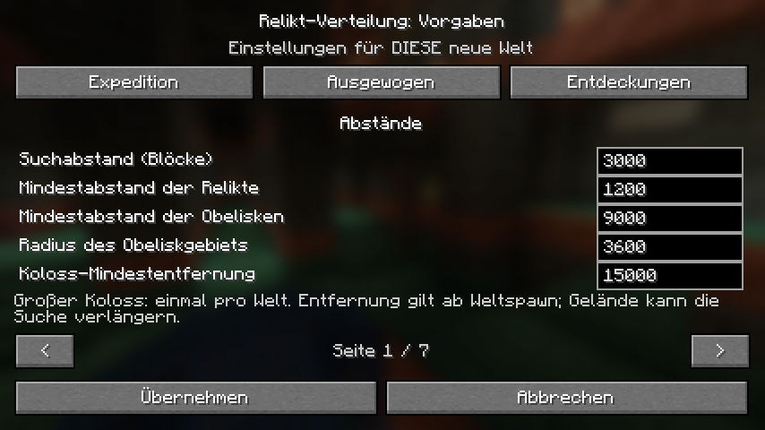

# Preset-dependent large Colossus distance

Local source revision, 3 November 2026. This is not a published update or a
replacement of the installed Alpha 5.0.4 profile artifacts.

## Behavior

The editable `colossusMinDistance` follows the presets: Expedition 30,000,
Balanced 15,000, Discoveries 8,000 blocks from the original shared world spawn.
Its permitted range is 4,000 to 100,000, at least twice the relic-center spacing.
The distance page displays all five fields at small client resolutions.

The resolver's first ring, subsequent expansion, acceptance check, asynchronous
chunk gate and unresolved planning safety disk use the saved distance. The
large Colossus retains its separate historical candidate grid and remains
unique. Expedition keeps the released 30,000–60,000 first ring and 20,000-block
expansion. Other minima start with a ring from the minimum to twice that value
and expand by the minimum when needed. Candidate priority, terrain, biome and
bounds checks remain in place. A lower minimum does not guarantee a nearby
valid site.

Missing fields in older configurations and frozen world journals mean 30,000,
even when the other values match a denser preset. Existing destinations and
pending search rings/cursors remain intact. Loading old files never rewrites
them merely to introduce the new field. The format and existing policy remain
compatible.

## Validation

- Production planner/journal tests passed: 1,008 worldgen-gate assertions,
  755,716 location-search assertions, 198,942 distribution assertions and
  168,816 settings assertions. The distribution suite's 30 seeds use synthetic
  terrain; these counts are not evidence of Minecraft terrain acceptance.
- Settings checks cover each preset, explicit custom values, invalid values,
  old files without the field, closer pending planning, saved closer targets
  and original bytes on read.
- All four player targets built and passed artifact/asset checks: Fabric and
  NeoForge, Minecraft 1.21.1 and 26.2. Test builds are staged under
  `build/colossus-preset-distance-20261103/artifacts/`; they use the current
  metadata version and must not be confused with published release binaries.
- An isolated real Fabric 1.21.1 client verified Balanced's 15,000, Discoveries'
  8,000, an editable custom 9,000 value, world-creation persistence, defaults
  isolation and the loaded world's read-only viewer. The screenshot below was
  inspected at 854×480, GUI scale 2. No controls overlap the footer.
- Two isolated real Fabric 26.2 server runs used Balanced and Discoveries.
  Both completed two boot cycles, `/locate` from two origins, map-origin/copy
  checks, natural generation of exactly one Colossus, exact transformed bounds,
  repeatable placement, datapack reload and unchanged original spawn/target
  after a restart and `/setworldspawn`.
- The server seed 731204 required distant suitable terrain. Both presets found
  X 96,136 / Z 48,504, after expanding beyond their initial rings. This is an
  explicit observed limit of minimum-distance tuning, not a promise of a
  nearer destination. The saved minima were 8,000 and 15,000 respectively.
- The new production journal reader also read the user's original
  `Living World Relics v5` journal without changing its bytes: minimum 30,000,
  target X −43,560 / Z 26,568. This is journal compatibility evidence, not a
  full modpack startup test of the new binaries. The installed profile JAR's
  SHA-256 remains unchanged.



Structured results, artifact hashes and test-run paths:
[colossus-preset-distance-20261103.json](colossus-preset-distance-20261103.json).

The first client harness attempt failed because a simultaneous port preparation
removed its generated diagnostic class. Port preparation and the client test
were then serialized; the client passed. No production change was required for
that harness failure.

## Reproduction

Use a working JDK 25 for the primary target and a JDK 21 for the 1.21.1 port:

```text
python tools/test_distribution.py --java-home <jdk25>
python tools/build.py --skip-generation --java-home <jdk25> --output <staging>
python tools/build_alpha5_port.py --loader fabric --minecraft 1.21.1 --java-home <jdk21> --output <staging>
python tools/build_alpha5_port.py --loader neoforge --minecraft 1.21.1 --java-home <jdk21> --output <staging>
python tools/build_alpha5_port.py --loader neoforge --minecraft 26.2 --java-home <jdk25> --output <staging>
python tools/test_distribution_client.py --minecraft 1.21.1 --artifact <staging-fabric-1.21.1-jar> --java-home <jdk21> --java <jdk21-java> --language de_de
python tools/test_distribution_server.py --accept-eula --java <jdk25-java> --artifact <staging-fabric-26.2-jar> --preset discovery
python tools/test_distribution_server.py --accept-eula --java <jdk25-java> --artifact <staging-fabric-26.2-jar> --preset balanced
```

Finish port preparation before the client test, because preparation regenerates
the port's test source tree. All runtime tests use isolated game directories.
