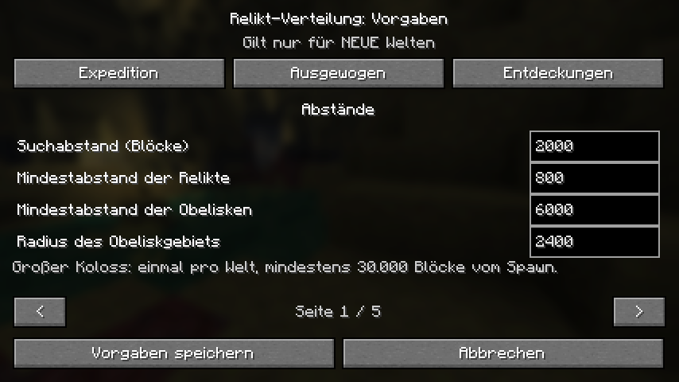
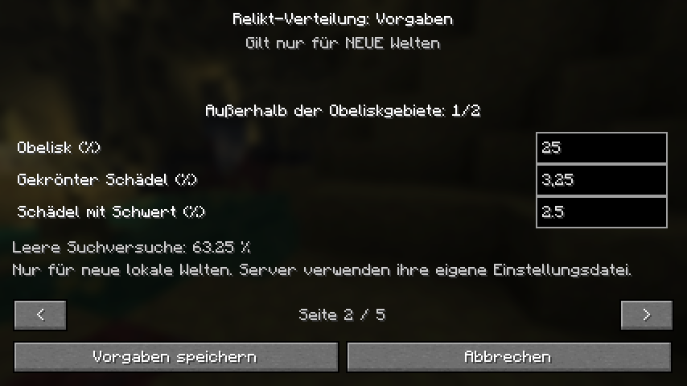

# Distribution settings verification

The November 1 [world-creation and biome revision](DISTRIBUTION_WORLD_MENU_20261101.md)
supersedes the original title/options menu described in this dated report.

Implemented October 30, 2026; final checks November 1. Feature branch only;
published Alpha 5.0.3 downloads and original Modrinth profiles were not changed.

The title/options menu provides three presets, editable block distances and
per-family percentages. Settings apply to new worlds and are frozen in their
planning journal. Existing v1/v2 worlds keep their original plans.
See [usage, validation ranges and server configuration](../technical/DISTRIBUTION_SETTINGS.md).

## Results

- All 43 selected packaging, resource, compatibility and documentation tests passed.
- All four player targets built: Fabric/NeoForge on Minecraft 1.21.1/26.2.
  Port verification checks Java targets, client-only mixin registration,
  required menu classes, all 40 template bindings and exclusion of diagnostic
  classes. No release tag or published artifact was replaced.
- Production Java suites passed: 168,791 settings assertions, 198,942 existing
  distribution assertions, 755,716 location-search assertions and 1,008 executor
  assertions. Settings tests cover exact v2/default-v3 equivalence, negative
  custom-grid coordinates, all local probe generation gates, deterministic
  forward/reverse exploration, custom spacing, 100% and zero family shares,
  saved-world isolation, malformed config preservation and missing-v3-settings
  rejection. Existing gameplay tests passed 677 assertions and 63 static mixin
  target checks.
- Real Fabric clients passed on both Minecraft versions at 854×480 pixels,
  GUI scale 2 (427×240 logical pixels). The probe presses actual title/options
  buttons and exercises presets, invalid-input save blocking, all five pages,
  comma percentages, mirrored Obelisk chances, save/reopen and cancel preserving
  an existing file. German 26.2 and English 1.21.1 were exercised. Screenshots
  were inspected. Client diagnostics remain outside player JARs.
- All four actual dedicated-server suites passed fresh boot and full process
  restart with nondefault settings: Fabric 1.21.1 with 100% Tower shares,
  NeoForge 1.21.1 with Balanced, and both 26.2 targets with Discoveries. Defaults
  were changed before reopening; the persisted settings, fingerprint, spawn and
  unique destination remained identical. Suites also exercise recipe packets,
  core/magnet behavior, physical trial/Vault rewards, aura and animal hooks.
  Reward tests use simulated players; no new two-human-client session is claimed.
- An isolated default-density fixture was converted to the historical v2
  journal schema and reopened with an invalid installation config. It retained
  its historical policy and loaded successfully, demonstrating that existing
  worlds do not read new-world defaults.
- Additional Fabric runs on both versions planned a Tower on the custom
  2,000-block grid, generated its chunk naturally and verified a nonempty saved
  structure start in the planned chunk. It remained present after restarting
  with changed installation defaults.

Actual 26.2 client captures:





Machine-readable artifact hashes, server evidence and client proofs are in
[the evidence bundle](distribution-settings-20261030.json). The optional client
runner requires the documented local launcher library/assets cache; it does
not read account tokens or open an existing save.

## Reproduction

Use JDK 25 for compilation and the matching Java runtime for each game version.

```text
python tools/test_distribution.py --java-home <jdk25>
python tools/test_gameplay.py --java-home <jdk25>
python tools/build.py --skip-generation --java-home <jdk25> --output build/settings-check/fabric26
python tools/build_alpha5_port.py --loader fabric --minecraft 1.21.1 --java-home <jdk25> --tasks build remapPortTestJar relicClasspath --output build/settings-check
python tools/build_alpha5_port.py --loader neoforge --minecraft 1.21.1 --java-home <jdk25> --tasks build relicClasspath --output build/settings-check
python tools/build_alpha5_port.py --loader neoforge --minecraft 26.2 --java-home <jdk25> --tasks build relicClasspath --output build/settings-check
python tools/test_distribution_client.py --minecraft <version> --artifact <fabric-jar> --java-home <jdk25> --java <matching-java>
python tools/test_alpha5_port_server.py --loader <loader> --minecraft <version> --artifact <jar> --test-mod <matching-test-jar> --java <matching-java> --accept-eula --suite --distribution-preset discovery --reload-preset expedition
python tools/test_alpha5_port_server.py --loader fabric --minecraft 26.2 --artifact <jar> --java <java25> --accept-eula --distribution-preset expedition --reload-preset invalid --historical-journal
```

Run port preparations sequentially: NeoForge 1.21.1 regenerates the shared
Fabric 1.21.1 adapter sources. The normal CI now also exercises nondefault
density and changed-default restart behavior on Fabric 26.2.

## Limits

Native NeoForge client UI was compiled but not separately driven in a graphical
client; its dedicated-server suites ran on both versions. No broad modpack
density/performance survey is claimed. Settings affect opportunities, so a
walking route can still contain no accepted relic. There is no migration of
existing worlds, retroactive generation or server configuration packet.
