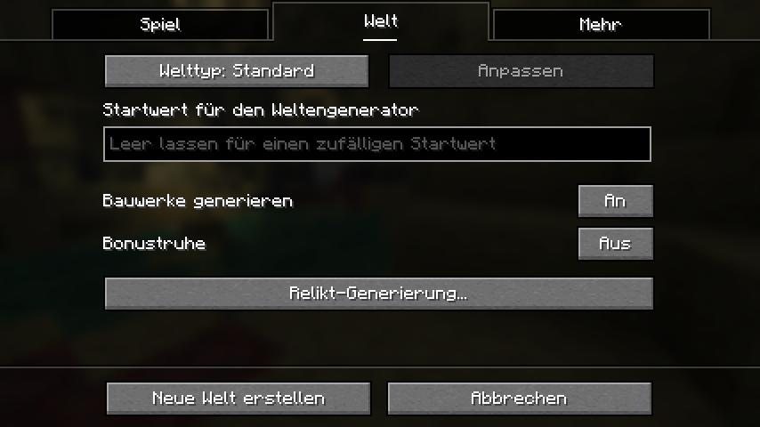
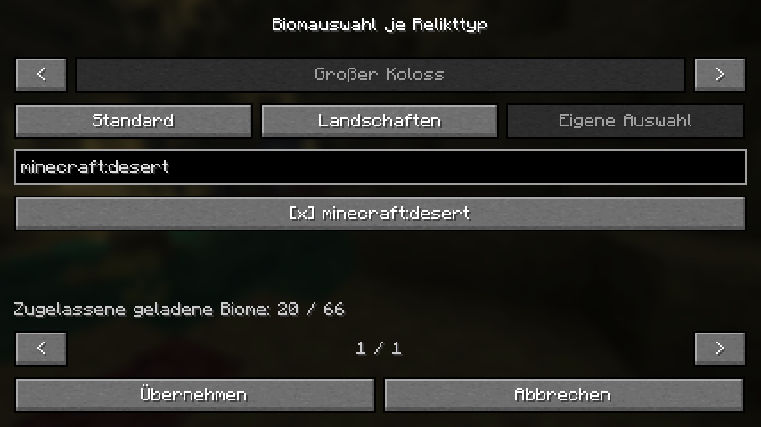
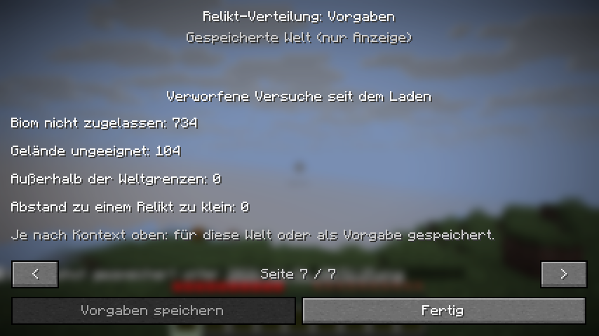

# World creation, biome rules and mod-list configuration

November 1, 2026. Revision of PR #1; no published release or launcher profile was
changed. This supersedes the title/options placement in the
[initial settings report](DISTRIBUTION_SETTINGS_20261030.md).

## Delivered behavior

- **Create World → World:** a Relic generation button below the vanilla
  generation switches. It is absent from the Game tab and disabled when vanilla
  structure generation is off or the world is debug. Apply changes this world's
  draft; Cancel discards editor changes. Personal defaults remain unchanged.
- **Fabric Mod Menu / NeoForge mod list:** future-world defaults outside a world;
  saved local-world settings and diagnostics read-only while playing. Mod Menu
  is optional and its API is a compile-only dependency. A server/legacy world
  without a readable gameplay snapshot displays an unavailable message rather
  than guessed settings. Client/server settings synchronization is not added.
- **Biome selection:** Standard, matching landscapes and exact custom selection
  per family. The actual datapack registry supplies the searchable list;
  namespaced IDs and installed mod display names are searchable. Tooltips show
  mapping groups and the mod name. Unmapped and missing IDs remain explicit.
- **Persistence:** actual creation-directory hooks write the per-world handoff
  before server start, on both game versions. The frozen journal takes over
  afterwards. Old config files and v3 journals without biome rules retain Standard.
- **Diagnostics:** separate biome, terrain, bounds and spacing rejection counts
  since server load, also available through `/relicsdistribution status`.
  Biome expansion retains terrain checks, the unique resolver and single-family
  ticket semantics; overlapping landscape tags choose one deterministic palette.

## Validation

- All four final player artifacts built and passed port/package verification.
- Real Fabric **26.2 with Mod Menu 20.0.3** exercised the actual Mod Menu factory;
  **1.21.1 without Mod Menu** exercised independent world creation. Both created
  actual integrated-server worlds through the vanilla Create button, froze
  custom density and biome selection, verified the on-disk handoff against the
  journal, checked Apply/Cancel isolation from defaults and opened the in-world
  read-only diagnostic viewer. Actual 854×480 screenshots were inspected.
- All four native dedicated-server suites passed fresh boot and full restart
  with changed installation defaults. NeoForge 1.21.1 also exercised Landscapes
  mode for all seven families. Fabric 1.21.1 generated and checked a natural Tower
  start on a custom 2,000-block grid. The historical-v2 fixture reopened with an
  invalid installation config and retained its plan.
- Production Java suites passed **168,803 settings**, **198,942 distribution**,
  **755,716 local-search**, **1,008 executor**, **677 gameplay** assertions and
  **63 static mixin target checks**. New cases cover tag-based mod-biome inclusion,
  unknown-biome rejection, exact custom replacement, deterministic palette
  routing, malformed rules and independent world/default/journal persistence.
- Diagnostic-only fingerprint capture was updated for the new validator
  constructor; it remains outside player artifacts.
- The empty-Colossus-biome fixture resolved unavailable on both fresh boot and
  restart, rather than leaving expedition maps pending indefinitely.
- All 43 selected packaging, resource, compatibility and documentation tests passed.

Hashes, source binding, full server evidence, GUI proofs and the settings of
the actual created worlds are in the [evidence bundle](distribution-world-menu-20261101.json).

## Reproduction and limits

Use the commands in the [initial report](DISTRIBUTION_SETTINGS_20261030.md), with
the new artifact paths. `tools/test_distribution_client.py --with-modmenu`
downloads/checks the matching optional Mod Menu artifact and exercises its
factory. The server runner accepts `--biome-mode landscapes`. Port preparation
must remain sequential for the shared 1.21.1 generated source tree.

Native NeoForge graphical clients were compiled but not separately driven;
dedicated servers ran on both versions. Large modpack landscape coverage and
performance still require paired exploration tests. Registry counts do not
measure land coverage or guarantee finds. Supported generation remains the
noise-based Overworld; biome settings do not add support for custom generator
implementations. No density migration or retroactive placement is performed.
