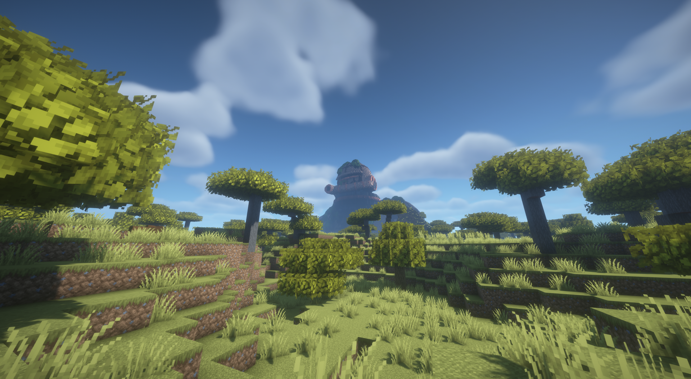
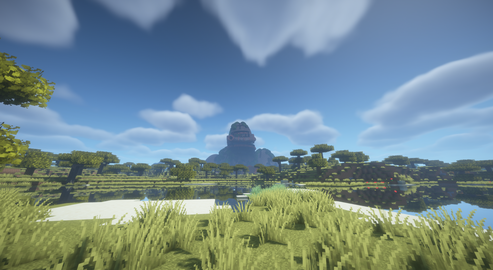
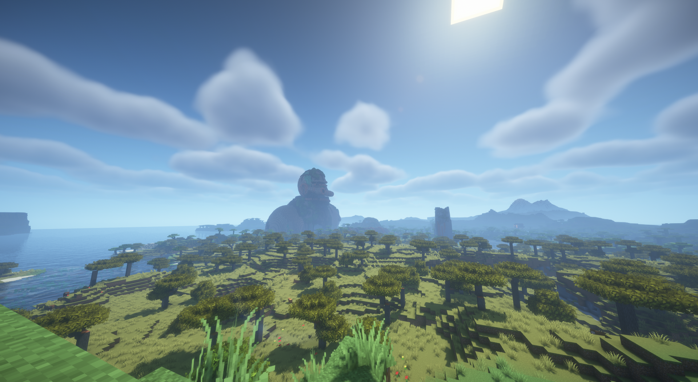

# Colossus V3 — in-game shader demo

Captured by the user on October 1, 2026, during the Alpha 3 in-game review.
These are **Minecraft screenshots with shaders**, not Blender renders or V4
assets. All three images show Colossus V3 in normal terrain.

The original PNGs are preserved byte-for-byte, with descriptive filenames.
The shader pack, shader version and graphics settings were not recorded.
The images demonstrate appearance, not measured performance or compatibility
with every shader/modpack. Known natural-worldgen limitations still apply.

## Savanna approach

Ground-level view through acacia trees, showing the Colossus's discovery scale.

## River view

Frontal view from the opposite bank, with water reflections and terrain in the
foreground.

## Landscape overview

Elevated side view showing the Colossus in the wider coastal savanna landscape.
Other structures visible in the scene are not identified as Relic Mod assets.

## Original capture names

| Demo file | Original screenshot |
| --- | --- |
| `colossus-v3-shaders-savanna.png` | `2026-10-01_21.38.24.png` |
| `colossus-v3-shaders-river.png` | `2026-10-01_21.38.45.png` |
| `colossus-v3-shaders-landscape.png` | `2026-10-01_21.39.13.png` |

See [Colossus](../README.md), the [V4 review notes](../docs/COLOSSUS_V4.md),
and the [Alpha 3 test report](../../../docs/testing/ALPHA_3_TEST_REPORT.md).
These demo captures supplement the earlier non-shader review; they do not
replace its terrain-contact and material-readability findings.
